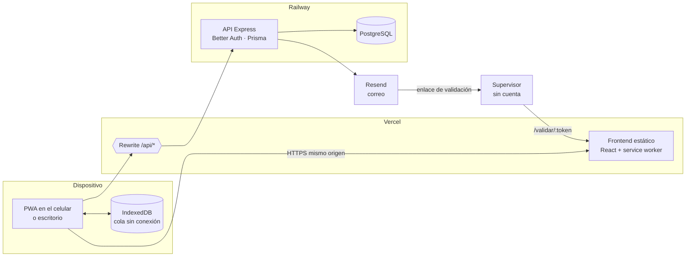
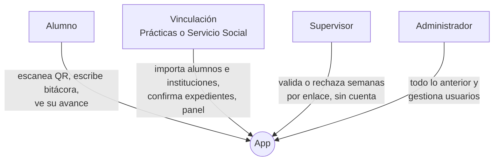
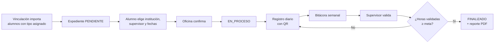
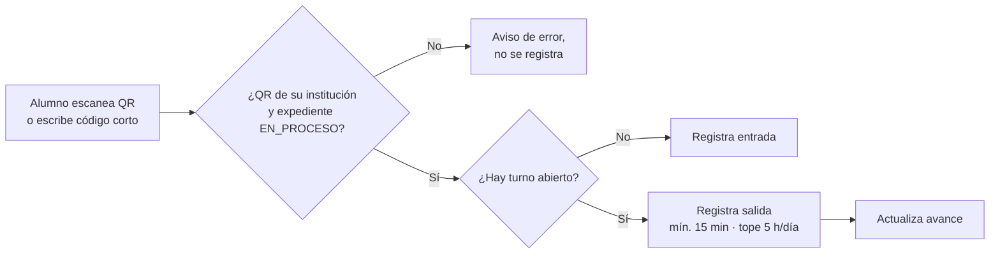
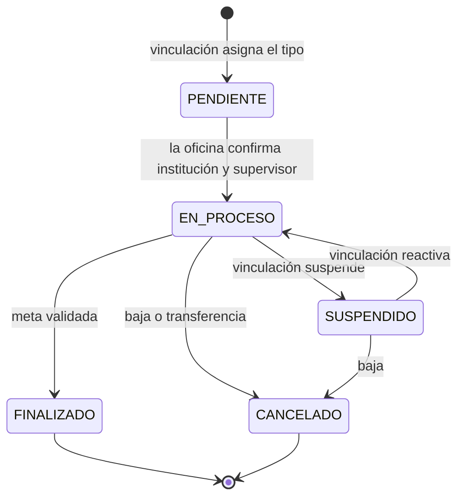
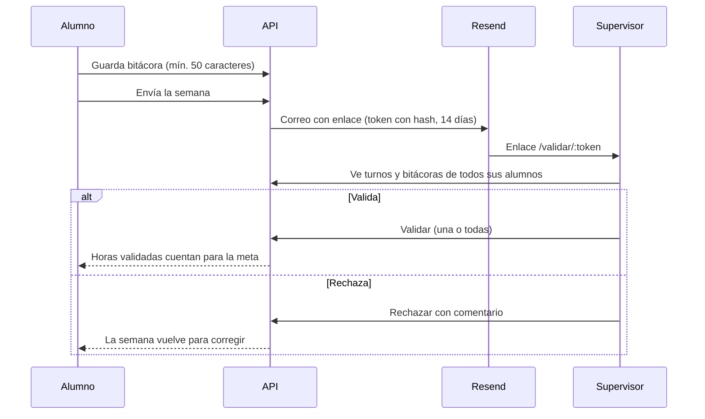
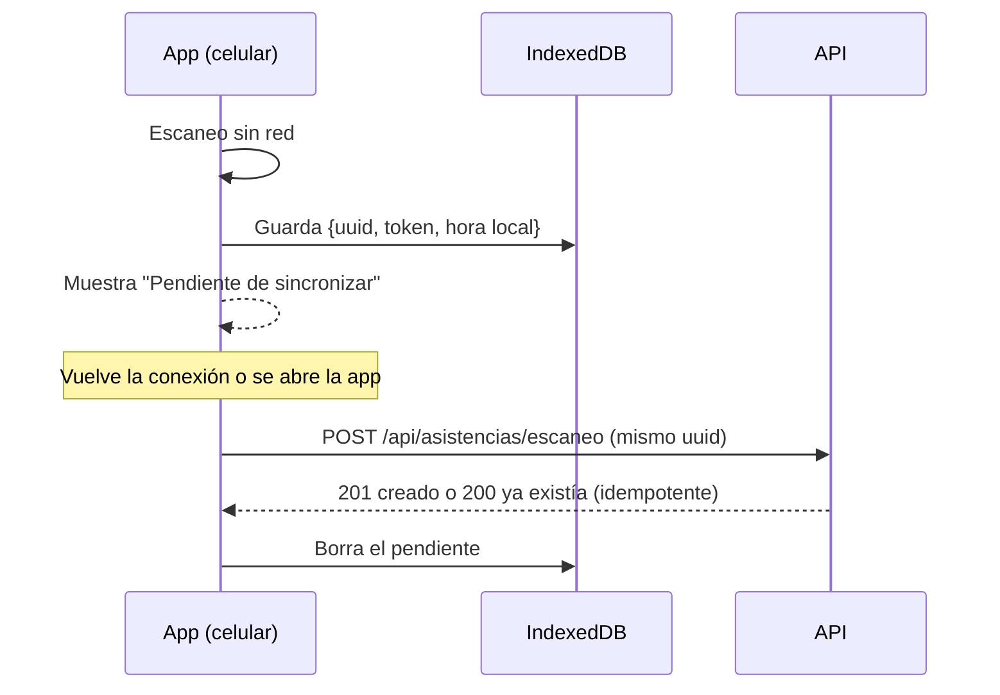

# Praxis — Servicio Social y Prácticas Profesionales (CBTIS 258)

PWA para que los alumnos registren su asistencia de **servicio social (480 h)** y **prácticas profesionales (240 h)** escaneando un código QR en su institución. La app calcula las horas, muestra el avance y la fecha estimada de término, el supervisor valida cada semana por un enlace y las oficinas de vinculación dan seguimiento desde un panel.

> **Fuente de verdad funcional:** [`docs/specs.md`](docs/specs.md) (v0.2). Los IDs `RF-xx`, `RN-xx` y `RNF-xx` que aparecen en el código y en las pruebas vienen de ahí.

## Inicio rápido

```bash
# 1. Base de datos: PostgreSQL local con las bases app_dev y app_test
#    (PostgreSQL nativo, o bien: docker compose up -d)

# 2. API en http://localhost:3000
cd backend && pnpm install && pnpm prisma migrate deploy && pnpm dev

# 3. PWA en http://localhost:5173
cd frontend && pnpm install && pnpm dev
```

Comprueba que todo responde: `curl http://localhost:3000/api/health` → `{"status":"ok"}`.

Guías detalladas:

| Proyecto | Guía |
| --- | --- |
| API REST | [`backend/README-BACKEND.md`](backend/README-BACKEND.md) |
| PWA | [`frontend/README-FRONTEND.md`](frontend/README-FRONTEND.md) |

## Estructura del repositorio

```
/
├── README.md
├── CLAUDE.md              # convenciones para el asistente de código
├── docs/specs.md          # especificaciones del MVP
├── odd/tasks/             # una tarea por archivo .md, con checklist
├── docker-compose.yml     # PostgreSQL local opcional (dev y test)
├── backend/               # Node + Express + Prisma → Railway
└── frontend/              # React + Vite (PWA) → Vercel
```

`backend/` y `frontend/` son **proyectos independientes**: cada uno tiene su `package.json`, su lockfile, su `tsconfig.json` y sus pruebas. Ninguno importa archivos del otro; el contrato entre ambos es la API REST (specs, sección 9).

## Stack y para qué se usa cada pieza

### Común

| Herramienta | Para qué se usa |
| --- | --- |
| **TypeScript** (`strict`) | Tipado estático en los dos proyectos; atrapa errores antes de ejecutar |
| **Node 22 LTS** | Runtime del backend y de las herramientas de build |
| **pnpm** | Gestor de paquetes, uno por carpeta (no hay workspace en la raíz) |
| **Zod** | Validación de datos: entrada de la API, variables de entorno y formularios |
| **Vitest** | Pruebas unitarias y de integración en ambos proyectos |
| **ESLint** | Revisión estática de estilo y errores comunes |

### Backend (`backend/`)

| Herramienta | Para qué se usa |
| --- | --- |
| **Express 5** | Servidor HTTP y rutas de la API REST |
| **PostgreSQL** | Base de datos; sus restricciones evitan turnos traslapados y expedientes duplicados |
| **Prisma** | ORM: esquema, migraciones y cliente tipado para consultar la base |
| **Better Auth** | Sesiones con cookie httpOnly; inicio de sesión con matrícula o correo |
| **Resend** | Envío de correos con el enlace de validación semanal al supervisor |
| **pdfmake** | Reporte de horas y actividades en PDF, listo para firma (RF-27) |
| **SheetJS** | Importación de alumnos e instituciones y exportaciones a Excel/CSV |
| **qrcode** | Generación del QR imprimible de cada institución (RF-13) |
| **Supertest** | Pruebas de las rutas HTTP contra una base PostgreSQL real de prueba |

### Frontend (`frontend/`)

| Herramienta | Para qué se usa |
| --- | --- |
| **React** | Interfaz de usuario |
| **Vite** | Servidor de desarrollo y build de producción |
| **React Router** | Navegación por rol: `/alumno`, `/vinculacion`, `/validar/:token` |
| **TanStack Query** | Peticiones a la API con caché, reintentos y estados de carga |
| **React Hook Form + Zod** | Formularios con validación |
| **Tailwind CSS** | Estilos con clases utilitarias, diseño primero para celular |
| **shadcn/ui** | Componentes accesibles (botones, diálogos, tablas) copiados al proyecto |
| **vite-plugin-pwa** | Manifest y service worker: app instalable y shell disponible sin red |
| **@zxing/browser** | Lectura del código QR con la cámara del celular |
| **MSW** | Simula la API en las pruebas del frontend |
| **React Testing Library** | Pruebas de componentes como las usaría una persona |
| **Playwright** | Pruebas de punta a punta en viewport de iPhone y Android |

### Despliegue

| Servicio | Qué despliega |
| --- | --- |
| **Vercel** | Solo `frontend/`; redirige `/api/*` a Railway para que la cookie sea del mismo origen |
| **Railway** | Solo `backend/` y la base PostgreSQL |

## Cómo funciona

### Arquitectura y despliegue

El navegador **nunca** llama a Railway directamente: todo pasa por `/api` en el mismo dominio, así Safari en iPhone no bloquea la cookie de sesión (RNF-05).



### Roles



### Ciclo completo de un alumno



### Registro de asistencia con QR



### Estados del expediente



### Validación semanal por el supervisor



### Registro sin conexión



## Reglas clave del dominio

| Regla | Resumen |
| --- | --- |
| RN-02 | Meta: 480 h servicio social, 240 h prácticas |
| RN-03 | Un solo expediente activo por alumno |
| RN-04 | Máximo 5 h acreditables por día |
| RN-09 | Un turno de menos de 15 min no se acredita |
| RN-11 | Solo las horas validadas cuentan para finalizar |
| RN-15 | Horas guardadas en UTC, mostradas en `America/Monterrey` |

La lista completa está en la sección 5 de [`docs/specs.md`](docs/specs.md).

## Forma de trabajo

- Se trabaja **una iteración a la vez** (specs, sección 14). Cada tarea vive en `odd/tasks/` con su checklist.
- Toda regla de negocio tiene al menos una prueba que la nombra, por ejemplo `it('RN-04: acredita máximo 300 minutos por día')`.
- Un cambio está terminado solo si `pnpm test` y `pnpm typecheck` pasan en el proyecto que se tocó.
- Commits con [Conventional Commits](https://www.conventionalcommits.org/es/v1.0.0/): `feat:`, `fix:`, `docs:`, `test:`, `chore:`.

## Estado

| Iteración | Entregable | Estado |
| --- | --- | --- |
| 0 | Andamiaje: proyectos, base de datos, migración inicial | ✅ |
| 1 | Autenticación, importación de alumnos, usuarios por oficina | ⏳ |
| 2 | Catálogo e importación de instituciones, QR | — |
| 3 | Expediente, escaneo, cálculo de horas, avance | — |
| 4 | Bitácora, validación por enlace y correo | — |
| 5 | Panel de vinculación, Excel y PDF | — |
| 6 | Registro sin conexión, recordatorios, pruebas en dispositivos | — |
| 7 | Piloto con Programación | — |
