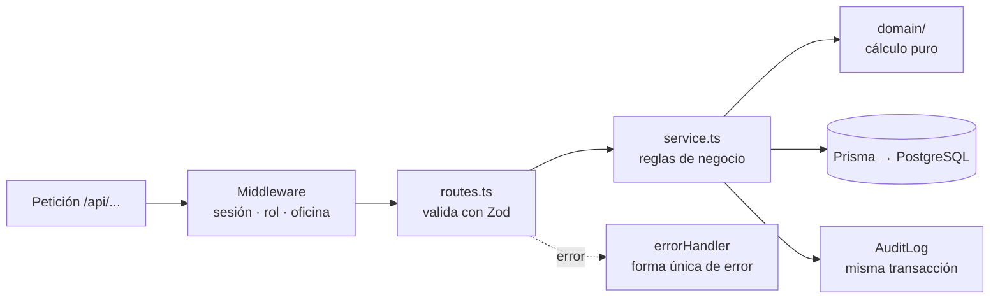

# Backend — API REST de Praxis

API en **Node 22 + Express 5 + TypeScript + Prisma + PostgreSQL**. Atiende a la PWA bajo `/api`, guarda las asistencias, calcula las horas y envía los enlaces de validación. Se despliega en Railway con Root Directory `backend`.

## Inicio rápido

```bash
cd backend
pnpm install                    # instala dependencias y genera el cliente de Prisma
cp .env.example .env            # ajusta DATABASE_URL
cp .env.test.example .env.test  # base de pruebas (app_test)
pnpm prisma migrate deploy      # crea las tablas en app_dev
pnpm dev                        # API en http://localhost:3000 (se recarga sola)
```

Verifica que está arriba:

```bash
curl http://localhost:3000/api/health
# {"status":"ok"}
```

## Requisitos

| Requisito | Versión | Notas |
| --- | --- | --- |
| Node | 22 LTS o superior | |
| pnpm | 10 | `npm i -g pnpm@10` |
| PostgreSQL | 16 o superior | Con las bases `app_dev` y `app_test`. Necesita la extensión `btree_gist` (viene incluida) |

### Preparar la base de datos

**Con PostgreSQL nativo** (por ejemplo, el instalador de Windows):

```bash
psql -U postgres -h localhost -c "CREATE DATABASE app_dev;"
psql -U postgres -h localhost -c "CREATE DATABASE app_test;"
```

**Con Docker**, desde la raíz del repositorio:

```bash
docker compose up -d   # usuario app / contraseña app, crea app_dev y app_test
```

Después aplica la migración en las dos bases:

```bash
pnpm prisma migrate deploy
DATABASE_URL=postgresql://<usuario>:<contraseña>@localhost:5432/app_test pnpm prisma migrate deploy
```

## Variables de entorno

Archivo `.env` (nunca se sube a git). Plantilla en `.env.example`.

| Variable | Obligatoria | Para qué |
| --- | --- | --- |
| `DATABASE_URL` | Sí | Conexión a PostgreSQL (`app_dev` en desarrollo) |
| `PORT` | No (3000) | Puerto de la API |
| `BETTER_AUTH_SECRET` | Sí | Secreto de sesiones, al menos 32 caracteres aleatorios |
| `BETTER_AUTH_URL` | Sí | URL pública por donde entra el navegador (dominio de Vercel) |
| `FRONTEND_ORIGIN` | Sí | Origen permitido de la PWA; las peticiones de otro origen a `/api/auth/*` reciben 403 |
| `SEED_ADMIN_EMAIL` | Solo para el seed | Correo del primer administrador |
| `SEED_ADMIN_PASSWORD` | Solo para el seed | Contraseña inicial, al menos 12 caracteres; se pide cambiarla al entrar |
| `SEED_ADMIN_NOMBRE` | No (`Administrador`) | Nombre visible del primer administrador |
| `SEED_DEMO_PASSWORD` | Solo para el seed demo | Contraseña de todos los usuarios demo, al menos 12 caracteres |
| `RESEND_API_KEY`, `MAIL_FROM` | En iteración 4 | Envío de correos al supervisor |
| `APP_TIMEZONE` | No | Fijo en `America/Monterrey` (RN-15) |

Las variables se validan con Zod al arrancar (`src/config/env.ts`). Si falta alguna obligatoria, el proceso se detiene con un mensaje claro.

Generar un secreto:

```bash
node -e "console.log(require('crypto').randomBytes(32).toString('base64url'))"
```

## Comandos

| Comando | Qué hace |
| --- | --- |
| `pnpm dev` | API en modo desarrollo con recarga automática (`tsx watch`) |
| `pnpm build` | Compila TypeScript a `dist/` |
| `pnpm start` | Ejecuta la versión compilada (lo usa Railway) |
| `pnpm test` | Corre todas las pruebas una vez (usa `.env.test`) |
| `pnpm test:watch` | Pruebas en modo observación |
| `pnpm typecheck` | Revisa tipos sin compilar |
| `pnpm lint` | ESLint |
| `pnpm prisma migrate dev --name <nombre>` | Crea una migración nueva a partir de cambios en `schema.prisma` |
| `pnpm prisma migrate deploy` | Aplica las migraciones pendientes |
| `pnpm prisma studio` | Explorador visual de la base en el navegador |
| `pnpm db:seed` | Crea el plantel CBTIS 258 y el primer administrador (se puede repetir; no sobrescribe nada) |
| `node dist/scripts/seed.js` | El mismo seed en Railway, con la versión compilada |
| `pnpm db:seed:demo` | Solo desarrollo: usuarios de vinculación, instituciones con QR, supervisores y alumnos de prueba. Requiere `pnpm db:seed` antes; si los datos ya existen, no hace nada |

## Probar la API a mano

| Prueba | Comando | Respuesta esperada |
| --- | --- | --- |
| Salud | `curl http://localhost:3000/api/health` | `200 {"status":"ok"}` |
| Ruta inexistente | `curl -i http://localhost:3000/api/no-existe` | `404` con `{"error":{"code":"NOT_FOUND",...}}` |
| JSON mal formado | `curl -i -X POST -H "Content-Type: application/json" -d "{mal" http://localhost:3000/api/health` | `400` con `code: "INVALID_JSON"` |

Todos los errores de la API usan la misma forma, con `message` en español:

```json
{ "error": { "code": "NOT_FOUND", "message": "La ruta solicitada no existe." } }
```

`details` aparece solo cuando aporta algo; por ejemplo, la lista de campos inválidos en un `VALIDATION_ERROR`.

Para ver los datos: `pnpm prisma studio` abre `http://localhost:5555`.

## Estructura

```
backend/
├── prisma/
│   ├── schema.prisma          # modelo de datos (specs 8.2)
│   └── migrations/            # SQL; incluye a mano las restricciones de specs 8.3
├── prisma.config.ts           # configuración del CLI de Prisma 7
├── src/
│   ├── server.ts              # arranque: escucha en PORT
│   ├── app.ts                 # crea la app Express (sin listen); lo importan las pruebas
│   ├── config/                # variables de entorno validadas con Zod
│   ├── lib/                   # prisma, errores, auth, correo, zona horaria
│   ├── domain/                # lógica pura: cálculo de horas (sin Express ni Prisma)
│   ├── middleware/            # sesión, rol, oficina, manejo de errores
│   ├── modules/<modulo>/      # routes · service · schemas · test por módulo
│   └── generated/prisma/      # cliente generado (no se sube a git)
└── test/                      # setup y factories de pruebas
```

### Cómo viaja una petición



Las rutas solo validan la entrada y llaman al servicio. La lógica de negocio vive en los servicios y en `domain/`.

## Base de datos

- El esquema parte de la sección 8.2 de las specs. Las tablas `users`, `sessions`, `accounts` y `verifications` son las que exige Better Auth.
- Convención de nombres en PostgreSQL: todo identificador (tablas, columnas, tipos enum, índices y restricciones) va en minúsculas y snake_case; las tablas van en plural (`alumnos`, `semanas_bitacora`). Los modelos y campos de Prisma conservan su nombre en TypeScript y se mapean con `@map` / `@@map`. Así el SQL escrito a mano no necesita comillas y se evita `user`, que es palabra reservada.
- Las restricciones que Prisma no puede declarar están en el SQL de la migración inicial:

| Restricción | Evita |
| --- | --- |
| `asistencia_sin_traslape` | Dos turnos que se enciman en el mismo expediente |
| `salida_despues_entrada` | Una salida anterior a la entrada |
| `un_turno_abierto` | Más de un turno abierto por expediente (RN-07) |
| `un_expediente_activo` | Más de un expediente activo por alumno (RN-03) |

- Los totales de horas se calculan con consultas, nunca se guardan como columna.
- Todas las fechas y horas se guardan como `timestamptz` en UTC (RN-15).

Para revisar que el esquema y la base coinciden:

```bash
pnpm prisma migrate diff --from-config-datasource --to-schema prisma/schema.prisma --script
# "-- This is an empty migration." = todo en orden
```

## Pruebas

- Las pruebas de rutas usan **Supertest** sobre `app.ts` y una base **real** (`app_test`), sin mocks de Prisma. Así también se prueban las restricciones SQL.
- Toda regla de negocio tiene una prueba que la nombra: `it('RN-04: acredita máximo 390 minutos por día')`.
- Toda ruta nueva prueba: caso feliz, validación inválida, sin sesión (401) y rol incorrecto (403).
- `test/setup.ts` vacía `app_test` al comienzo de **cada archivo** de pruebas, y solo si el nombre de la base termina en `_test`. Dentro de un archivo, las pruebas comparten los datos que arman con `test/factories.ts`.

## Problemas comunes

| Síntoma | Solución |
| --- | --- |
| `Invalid environment variables: DATABASE_URL` | Falta `.env` o la variable está vacía |
| `fe_sendauth: no password supplied` | La URL de conexión no lleva contraseña |
| `EPERM ... symlink` al instalar | Por eso `.npmrc` usa `node-linker=hoisted`; no lo borres |
| `Cannot find module '../generated/prisma/client.js'` | Ejecuta `pnpm prisma generate` |
| Puerto 3000 ocupado | Cambia `PORT` en `.env` o cierra el proceso anterior |
