# Flujo de la app desde la interfaz

Este documento muestra cómo se usa la app **hoy**, pantalla por pantalla, para cada rol: administrador, vinculación, alumno y supervisor. Describe lo que está construido en `frontend/`, no lo que piden las specs; los huecos conocidos están al final.

> Estado: 15 de noviembre de 2026, después de la tarea 0054 (guías del piloto). Cuando se agregue una pantalla, actualiza el diagrama del rol que la usa.

## Mapa de pantallas

| Ruta | Pantalla | Quién entra |
| --- | --- | --- |
| `/entrar` | Inicio de sesión | Cualquiera sin sesión |
| `/activar` | Activar cuenta | Alumno importado, sin sesión |
| `/cambiar-contrasena` | Cambio de contraseña obligatorio | Usuario con `debeCambiar` |
| `/alumno` | Mi avance (inicio) | Alumno |
| `/alumno/registrar` | Registrar asistencia (QR o código corto) | Alumno |
| `/alumno/expediente` | Completar expediente | Alumno |
| `/alumno/historial` | Historial semanal y bitácora | Alumno |
| `/vinculacion` | Panel de la oficina | Vinculación y administrador |
| `/vinculacion/instituciones` | Catálogo de instituciones | Vinculación y administrador |
| `/vinculacion/instituciones/nueva` y `/:id/editar` | Formulario de institución | Vinculación y administrador |
| `/vinculacion/importar/alumnos` | Importar alumnos | Vinculación y administrador |
| `/vinculacion/importar/instituciones` | Importar instituciones | Vinculación y administrador |
| `/vinculacion/expedientes/:id` | Detalle del alumno: acciones sobre el expediente, semanas, reporte y auditoría | Vinculación y administrador |
| `/vinculacion/correcciones` | Correcciones pendientes | Vinculación y administrador |
| `/vinculacion/usuarios/nuevo` | Crear usuario de oficina | Solo administrador |
| `/vinculacion/oficinas/firmas` | Firmas de las oficinas | Solo administrador |
| `/validar/:token` | Validar semanas | Supervisor (enlace del correo, sin cuenta) |
| Cualquier otra | "Página no encontrada" | Cualquiera |

## Entrada a la app (todos los roles)

Todos usan la misma pantalla de inicio de sesión. El campo acepta matrícula (alumno) o correo (vinculación y administrador). Antes de mostrar cualquier pantalla, la app revisa si el usuario debe cambiar su contraseña.

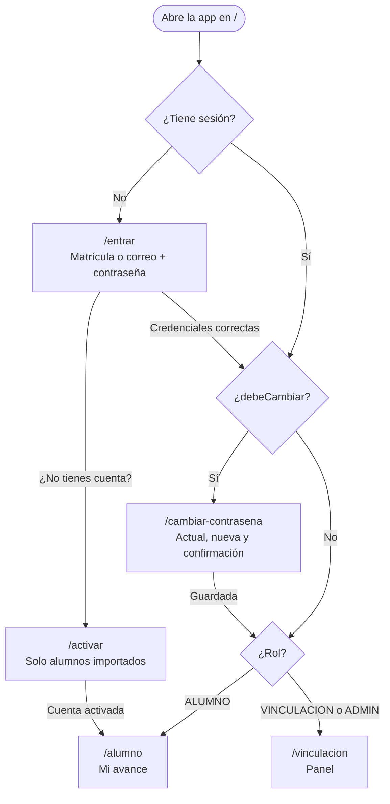

- `debeCambiar` se activa cuando el administrador crea un usuario o cuando vinculación restablece una contraseña (contraseña temporal, RF-04).
- Si un usuario abre una ruta de otro rol, la app lo regresa a su propio inicio.
- "Cerrar sesión" está en el encabezado de ambos layouts y lleva a `/entrar`. Junto a él hay un selector **Tema** (Claro, Oscuro o Sistema).
- Un alumno que ya inició sesión antes puede abrir la app sin conexión: ve su nombre y los botones **Registrar** e **Historial** (ver Registrar asistencia).

## Administrador

El administrador ve todo lo que ve vinculación, de ambas oficinas, más las opciones **Usuarios** (crear cuentas de vinculación) y **Firmas de las oficinas**.

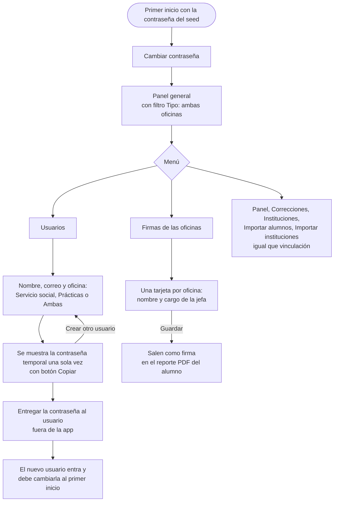

- La oficina define qué expedientes ve el usuario de vinculación (RN-03b). "Ambas" equivale a `oficina = null`.
- No hay pantalla para listar, editar ni desactivar usuarios; solo para crearlos.
- **Firmas de las oficinas** solo existe para el administrador (RF-27, RF-29): el nombre y el cargo de cada oficina se imprimen en la firma del reporte PDF.

## Vinculación

Vinculación prepara el catálogo (instituciones y alumnos) y da seguimiento desde el panel. Solo ve los expedientes de su oficina; el filtro "Tipo" aparece únicamente si tiene ambas oficinas o es administrador.

En pantalla no aparece la palabra "vinculación": cada usuario ve el nombre de su oficina (specs §4). Las rutas siguen siendo `/vinculacion/...`, pero eso es interno.

| Usuario | Título del panel | Etiqueta del encabezado |
| --- | --- | --- |
| Administrador | Panel general | Administrador |
| Oficina de prácticas | Panel de Prácticas Profesionales | Oficina de Prácticas Profesionales |
| Oficina de servicio social | Panel de Servicio Social y Titulación | Oficina de Servicio Social y Titulación |
| Usuario con ambas oficinas | Panel general | Ambas oficinas |

### Preparar el semestre

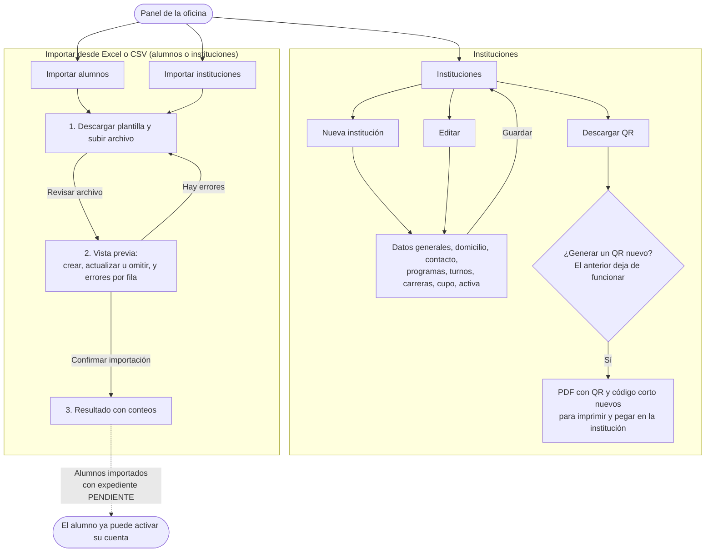

- Descargar el QR **siempre rota** el token y el código corto (RF-13, RF-15). Hazlo solo cuando vayas a reemplazar el impreso.
- Al importar alumnos se crea su expediente en estado PENDIENTE con la meta de horas del programa (RN-02).

### Seguimiento en el panel

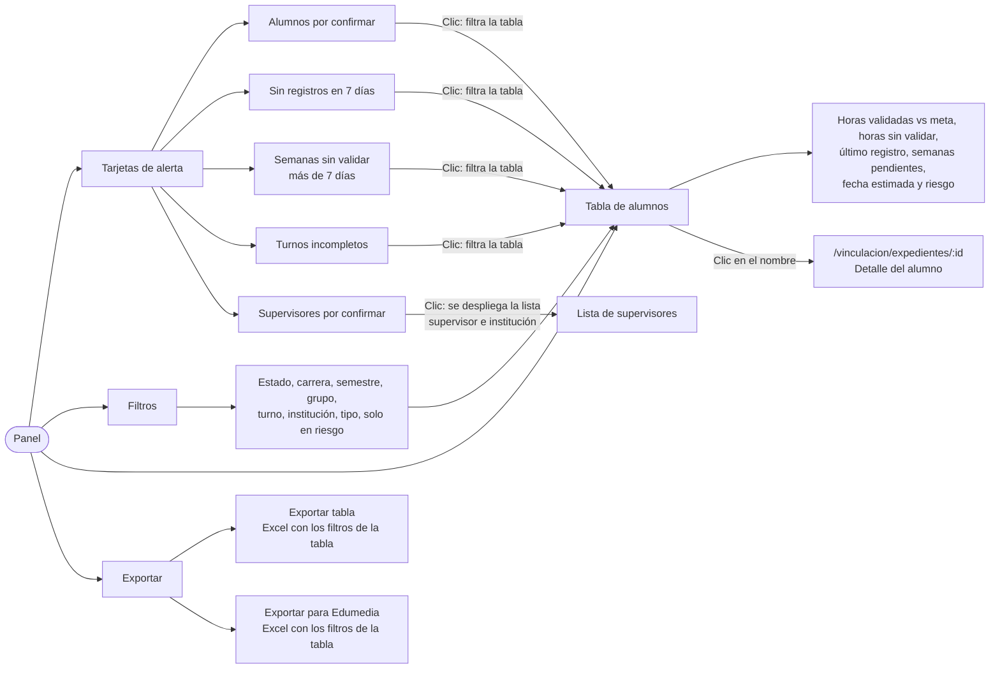

- El panel solo consulta; las acciones sobre un alumno están en su detalle.
- **Alumnos por confirmar** filtra la tabla por expedientes PENDIENTE. **Supervisores por confirmar** no filtra: despliega una lista.
- Las exportaciones usan los filtros de la tabla, pero no el filtro de la tarjeta de alerta; si hay una activa, la pantalla lo avisa.
- "En riesgo" sigue la regla RN-06a; el panel solo muestra lo que calcula la API.

### Detalle del alumno

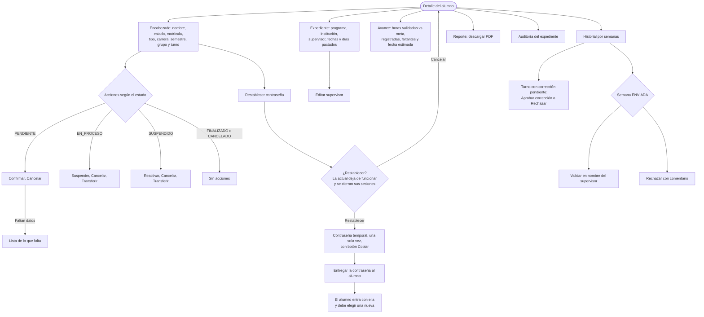

- **Confirmar** pasa el expediente de PENDIENTE a EN_PROCESO (RF-10). Si falta algo, la API responde con la lista y la pantalla la muestra.
- Suspender, reactivar, cancelar y transferir abren un panel con su formulario antes de aplicarse (RF-11, RF-12, RN-12).
- **Validar en nombre del supervisor** y **Rechazar** aparecen en las semanas ENVIADAS y piden un motivo (RF-22).
- Cualquier oficina puede restablecer la contraseña de cualquier alumno del plantel: es soporte, no gestión del expediente.
- Si el alumno nunca activó su cuenta, restablecer se la crea; también sirve cuando la activación falla porque su nombre no coincide.

### Correcciones pendientes

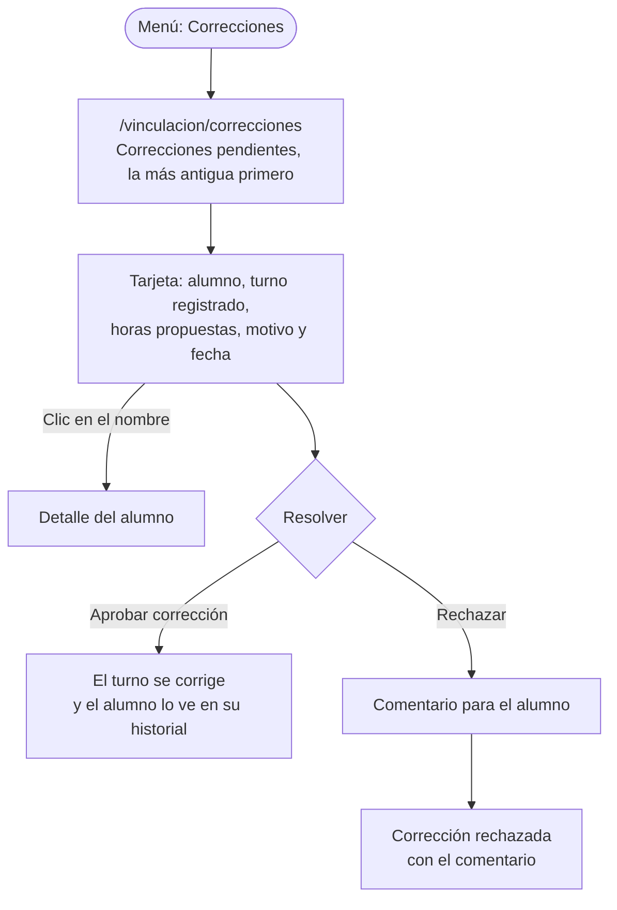

- Solo se listan las solicitudes de los alumnos de la oficina del usuario (RN-03b). Sin solicitudes: "No hay correcciones pendientes".
- La misma solicitud se puede resolver desde el historial del alumno en su detalle.

## Alumno

El alumno vive en una sola pantalla de inicio ("Mi avance") y llega a las demás desde sus botones y avisos.

### Activar la cuenta y completar el expediente

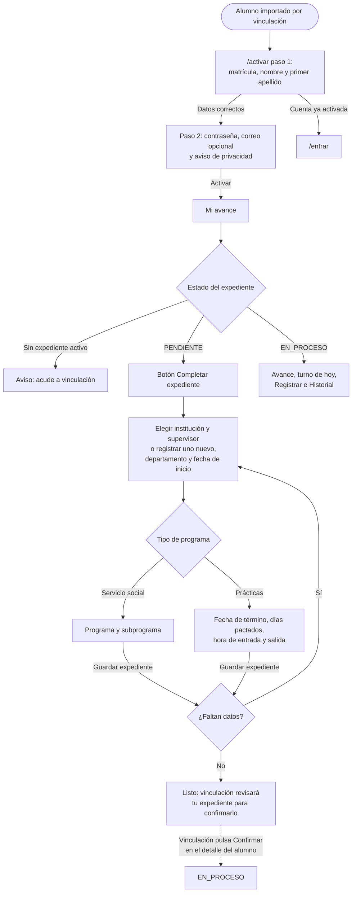

### Registrar asistencia

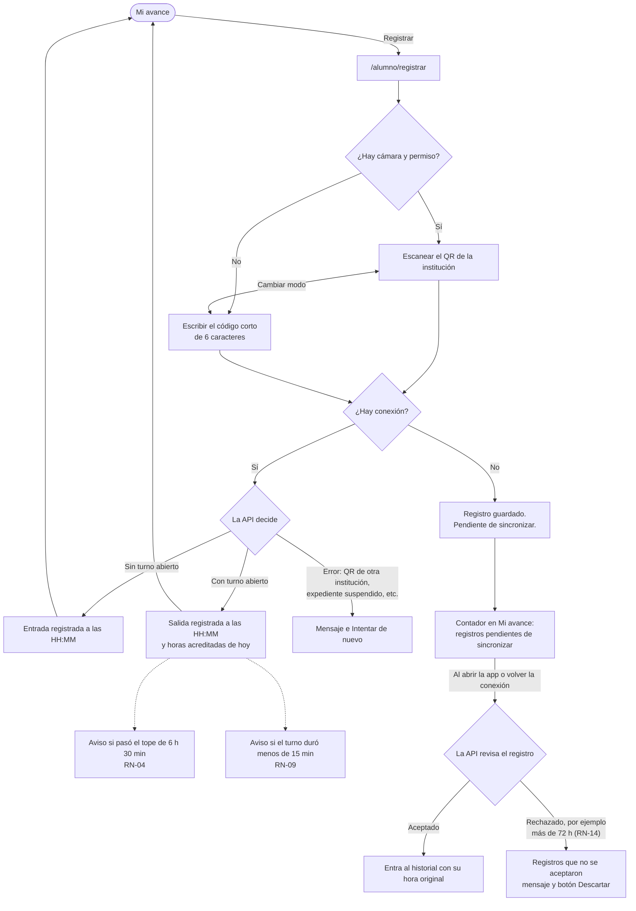

- El botón Registrar se desactiva si el expediente está SUSPENDIDO.
- Cola sin conexión (RF-16): el registro se guarda en el dispositivo con la hora real y un identificador propio, así que reenviarlo no lo duplica. Se sincroniza al abrir la app y al volver la conexión.
- Un registro con más de 72 h de antigüedad ya no se acepta (RN-14); queda en "Registros que no se aceptaron" hasta que el alumno lo descarta.
- Si la sesión expiró, la app pide iniciar sesión para enviar los registros pendientes.
- Sin conexión, Mi avance muestra "Sin conexión. Puedes registrar tu asistencia; se enviará cuando tengas conexión." y la app abre para un alumno conocido.

### Avisos y recordatorios en Mi avance

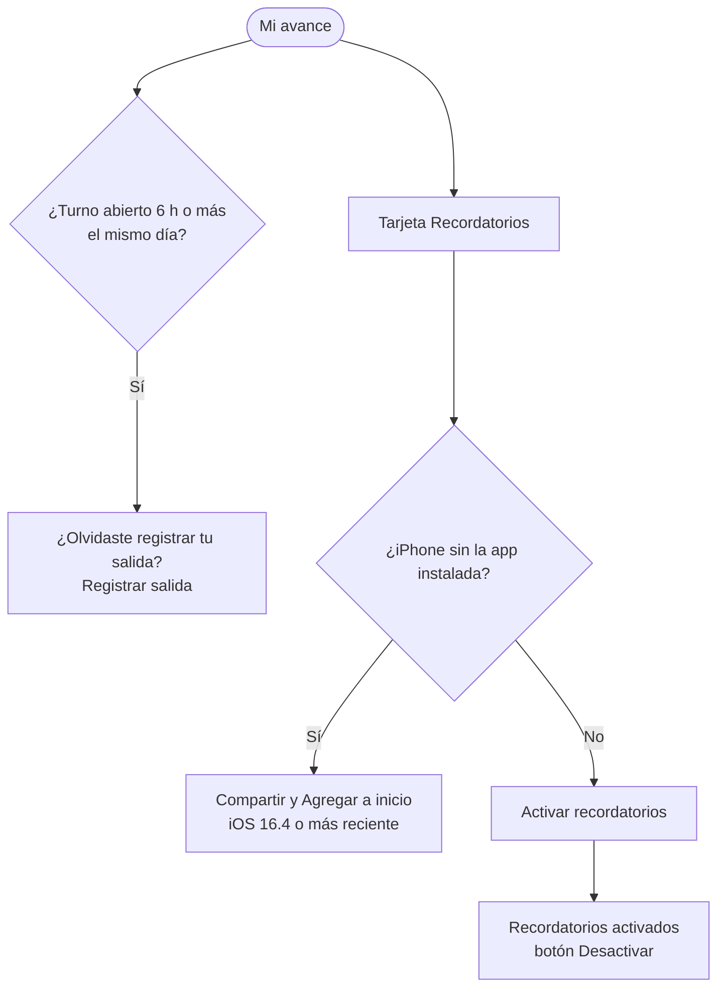

- Los recordatorios son notificaciones push (RF-28): salida olvidada y bitácora de la semana. Los envían tareas programadas, no una pantalla.
- Sin las claves del servidor, la tarjeta no aparece; el aviso "¿Olvidaste registrar tu salida?" sí se muestra dentro de la app.

### Bitácora semanal

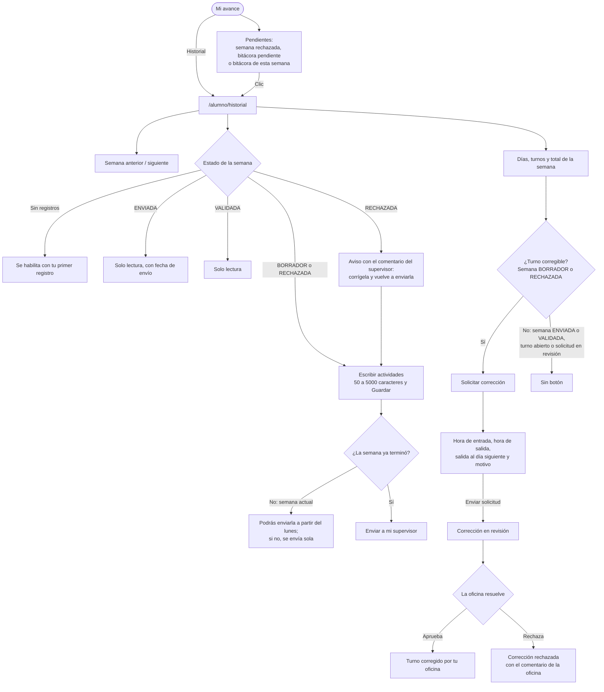

- **Solicitar corrección** (RF-17) solo aparece mientras la semana está en BORRADOR o RECHAZADA, para que la firma del supervisor no cambie. Tampoco aparece con un turno abierto, con el expediente no activo ni si ya hay una solicitud en revisión.
- La entrada se queda en el mismo día (RN-15); la salida puede ser del día siguiente y no puede ser futura.

### Horas de libreta

El alumno puede copiar a la app turnos que ya tenía firmados en su libreta de papel (RF-17a, RN-19).

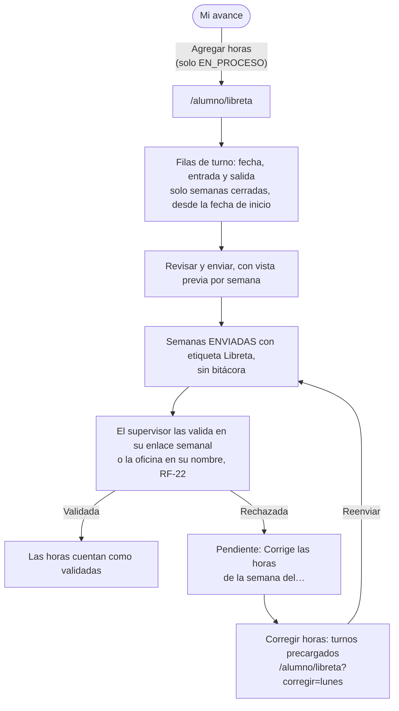

- Los turnos de libreta no tienen **Solicitar corrección**; se corrigen reemplazándolos cuando se rechaza la semana.
- Las métricas 1 y 3 del piloto los excluyen; la 2 incluye las semanas de libreta (ver [`piloto.md`](piloto.md)).

## Supervisor

El supervisor no tiene cuenta. Recibe un correo con un enlace que vale 14 días y valida desde ahí las semanas de todos sus alumnos.

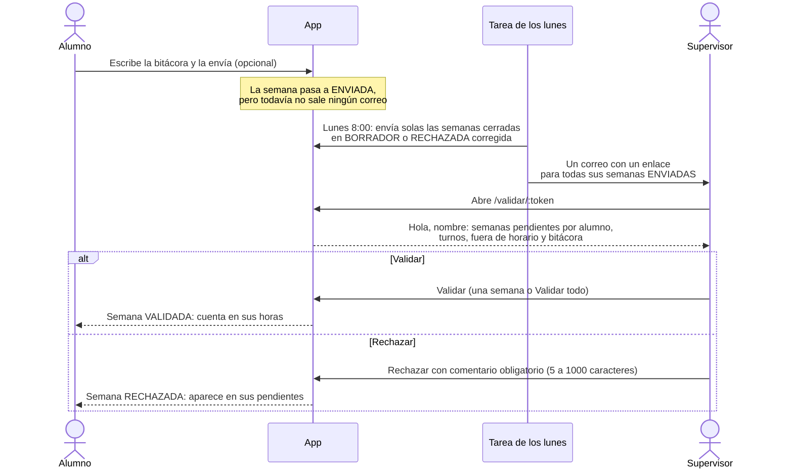

- Si el enlace no existe: "Este enlace no es válido". Si pasaron 14 días: "Este enlace venció. Usa el del correo más reciente".
- El enlace se puede usar varias veces mientras no venza; una semana ya resuelta muestra "Esta semana ya se había resuelto".
- En producción lo dispara un servicio cron de Railway (lunes 8:00, hora de Monterrey). En desarrollo no hay cron: el correo se dispara con `pnpm job:resumen-semanal` o, para un enlace de prueba, `pnpm dev:enlace` (en `backend/`). Sin `RESEND_API_KEY`, el correo se imprime en la consola del backend.

## Ciclo de vida de una semana

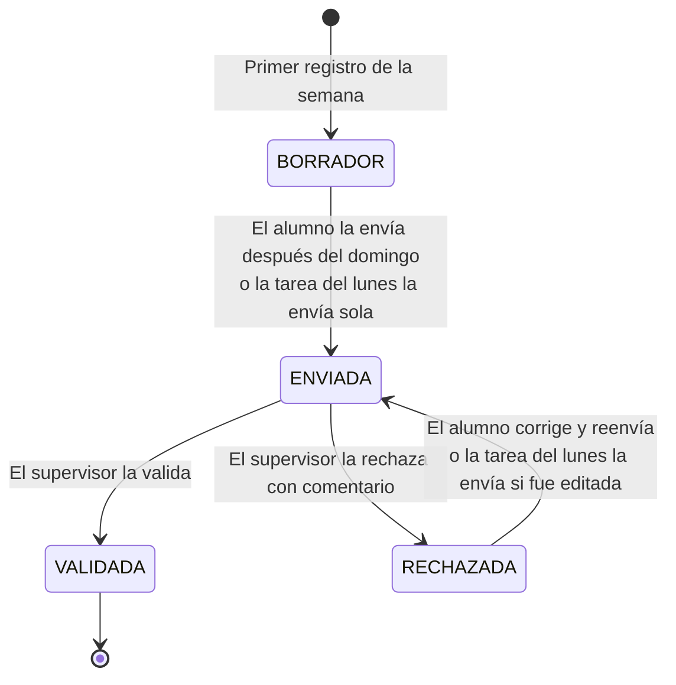

- Para enviarse, la bitácora necesita al menos 50 caracteres y el expediente debe estar EN_PROCESO o SUSPENDIDO.
- Solo las horas de semanas VALIDADAS cuentan como avance validado; las demás aparecen como "registradas sin validar".

## Tareas programadas (no son pantallas)

Corren en el servidor y alimentan el flujo; se configuran como indica [`despliegue.md`](despliegue.md).

| Tarea | Cuándo | Qué hace |
| --- | --- | --- |
| Resumen semanal (`job:resumen-semanal`) | Lunes 8:00 | Envía solas las semanas cerradas y manda a cada supervisor un correo con su enlace de validación |
| Recordatorio de salida (`job:recordatorio-salida`) | Cada 15 minutos, el mismo día | Notificación push al alumno con un turno abierto que olvidó su salida (RF-28) |
| Recordatorio de bitácora (`job:recordatorio-bitacora`) | Domingo 18:00 | Notificación push a quien tiene la bitácora de la semana pendiente (RF-28) |
| Métricas del piloto (`job:metricas-piloto`) | A mano | Reporte con días por semana, tiempo de validación y turnos incompletos ([`piloto.md`](piloto.md)) |

## Huecos conocidos

Lo que falta o sigue siendo manual hoy:

| Hueco | Efecto |
| --- | --- |
| Asignar el siguiente programa (`POST /api/expedientes/asignar`) no tiene pantalla | Hay que hacerlo por la API |
| Cambiar el supervisor de un expediente ya confirmado (misma institución, `PATCH /api/expedientes/:id`) no tiene pantalla | La oficina no puede reasignar al alumno; por eso un supervisor con expedientes activos no se puede desactivar sin pasar por la API |
| No se pueden listar, editar, desactivar ni restablecer la contraseña de usuarios de oficina | El administrador solo puede crearlos; si alguien de vinculación olvida su contraseña, no hay forma de recuperarla desde la app |
| No hay forma de editar un turno una vez enviada la semana | Las correcciones del alumno solo valen en semanas BORRADOR o RECHAZADA |
| El alumno no tiene las pantallas **Instituciones** ni **Perfil** de las specs (§10) | Instalar la app y activar notificaciones se hace desde Mi avance (tarjeta Recordatorios); no hay buscador de instituciones |
| Falta el aviso de privacidad integral | La app muestra la versión simplificada aprobada y dice que el integral se consulta en las oficinas de vinculación (specs §13, pregunta 7) |
| Pruebas manuales en celulares reales pendientes | Cámara, instalación en iPhone, push y modo sin conexión están cubiertos por pruebas automáticas, no probados en dispositivos |

Ya cubierto por la interfaz, en el detalle del alumno: confirmar el expediente, suspender, reactivar o cancelar, transferir de institución, validar o rechazar semanas en nombre del supervisor, resolver correcciones y editar o confirmar al supervisor. En **Editar institución** la oficina lista, agrega, edita y desactiva o reactiva supervisores; un supervisor con expedientes activos (PENDIENTE, EN_PROCESO o SUSPENDIDO) no se puede desactivar.

Mientras tanto, para probar el flujo completo de un alumno ya en proceso, usa los datos demo (`pnpm db:seed:demo` en `backend/`): Ana y Bruno ya tienen expedientes EN_PROCESO.
