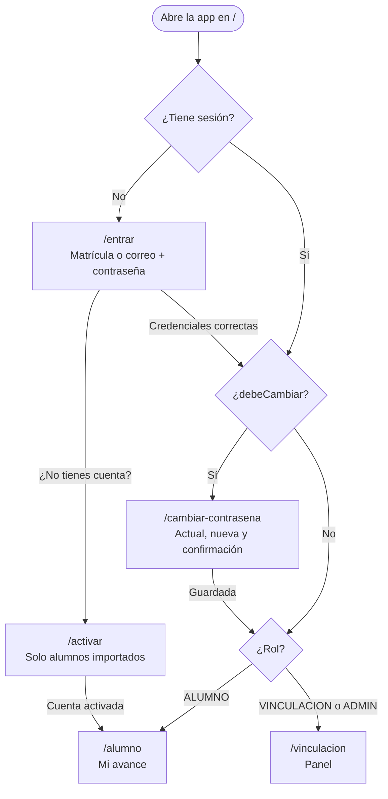
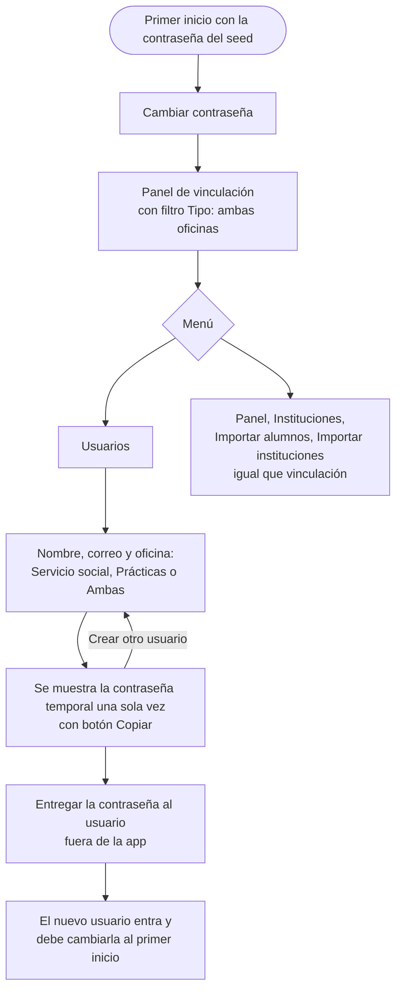
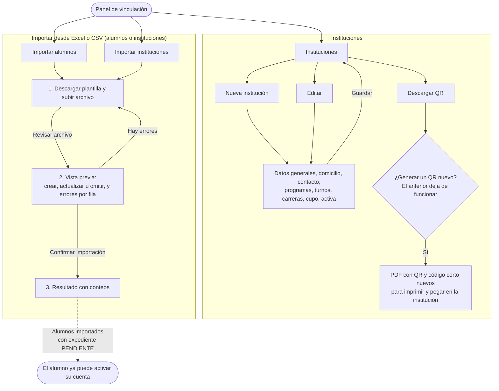
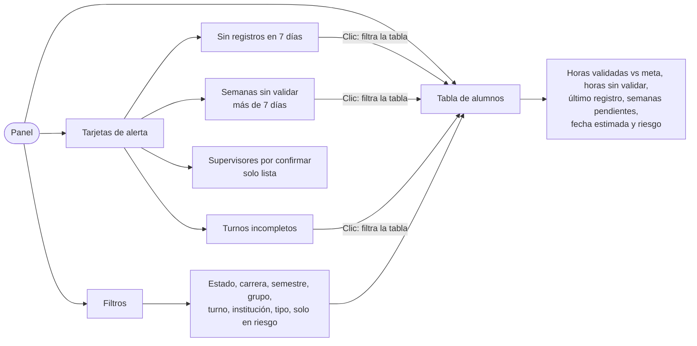
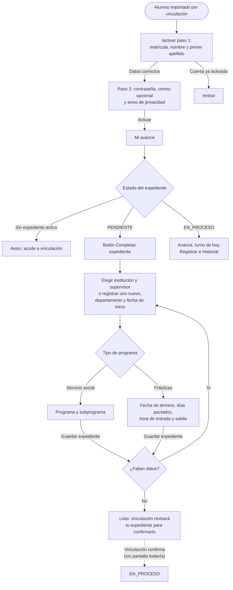
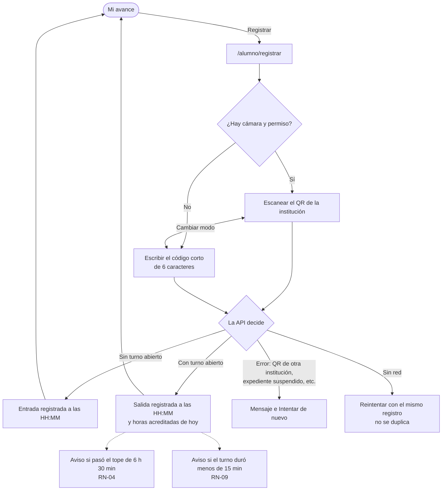
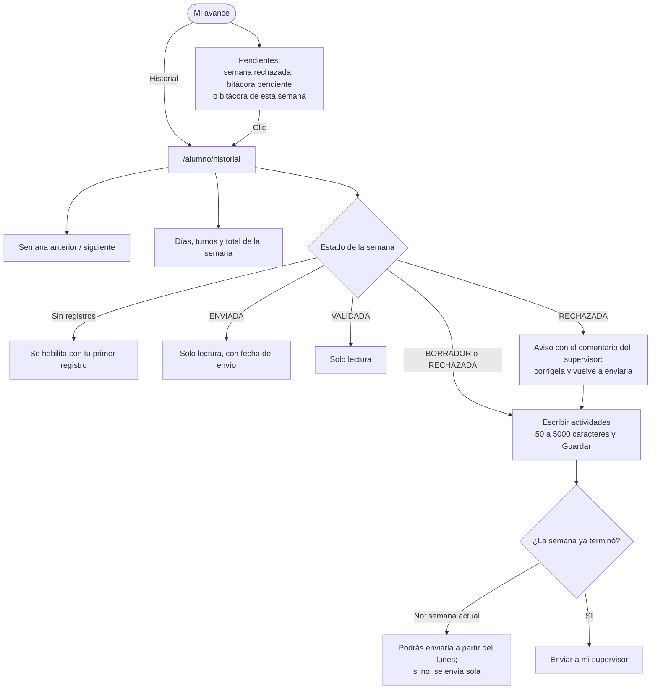
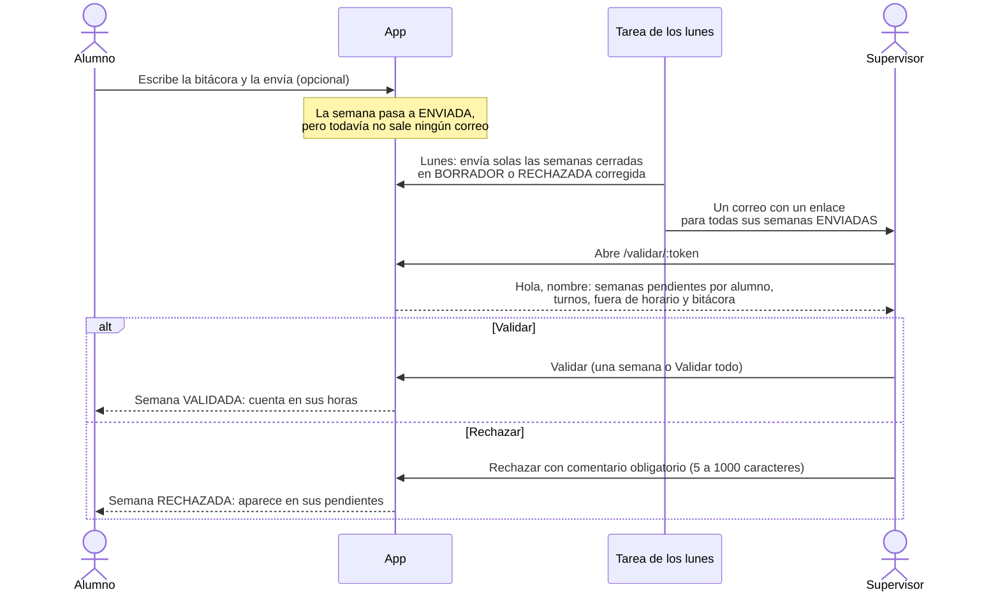
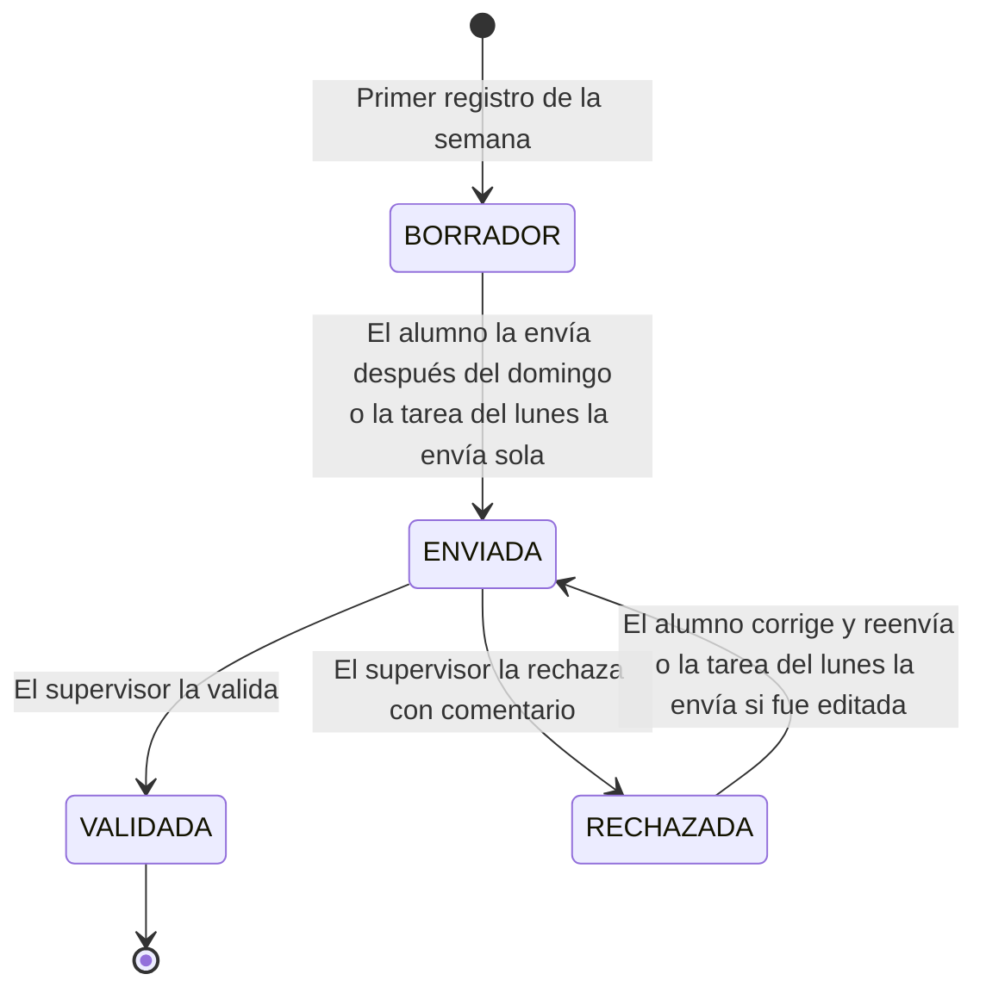

# Flujo de la app desde la interfaz

Este documento muestra cómo se usa la app **hoy**, pantalla por pantalla, para cada rol: administrador, vinculación, alumno y supervisor. Describe lo que está construido en `frontend/`, no lo que piden las specs; los huecos conocidos están al final.

> Estado: noviembre de 2026, después de la tarea 0027 (panel de vinculación). Cuando se agregue una pantalla, actualiza el diagrama del rol que la usa.

## Mapa de pantallas

| Ruta | Pantalla | Quién entra |
| --- | --- | --- |
| `/entrar` | Inicio de sesión | Cualquiera sin sesión |
| `/activar` | Activar cuenta | Alumno importado, sin sesión |
| `/cambiar-contrasena` | Cambio de contraseña obligatorio | Usuario con `debeCambiar` |
| `/alumno` | Mi avance (inicio) | Alumno |
| `/alumno/registrar` | Registrar asistencia (QR o código corto) | Alumno |
| `/alumno/expediente` | Completar expediente | Alumno |
| `/alumno/historial` | Historial semanal y bitácora | Alumno |
| `/vinculacion` | Panel de la oficina | Vinculación y administrador |
| `/vinculacion/instituciones` | Catálogo de instituciones | Vinculación y administrador |
| `/vinculacion/instituciones/nueva` y `/:id/editar` | Formulario de institución | Vinculación y administrador |
| `/vinculacion/importar/alumnos` | Importar alumnos | Vinculación y administrador |
| `/vinculacion/importar/instituciones` | Importar instituciones | Vinculación y administrador |
| `/vinculacion/usuarios/nuevo` | Crear usuario de vinculación | Solo administrador |
| `/validar/:token` | Validar semanas | Supervisor (enlace del correo, sin cuenta) |

## Entrada a la app (todos los roles)

Todos usan la misma pantalla de inicio de sesión. El campo acepta matrícula (alumno) o correo (vinculación y administrador). Antes de mostrar cualquier pantalla, la app revisa si el usuario debe cambiar su contraseña.

- `debeCambiar` se activa cuando el administrador crea un usuario o cuando vinculación restablece una contraseña (contraseña temporal, RF-04).
- Si un usuario abre una ruta de otro rol, la app lo regresa a su propio inicio.
- "Cerrar sesión" está en el encabezado de ambos layouts y lleva a `/entrar`.

## Administrador

El administrador ve todo lo que ve vinculación, de ambas oficinas, más la opción **Usuarios** para crear cuentas de vinculación.

- La oficina define qué expedientes ve el usuario de vinculación (RN-03b). "Ambas" equivale a `oficina = null`.
- No hay pantalla para listar, editar ni desactivar usuarios; solo para crearlos.

## Vinculación

Vinculación prepara el catálogo (instituciones y alumnos) y da seguimiento desde el panel. Solo ve los expedientes de su oficina; el filtro "Tipo" aparece únicamente si tiene ambas oficinas o es administrador.

### Preparar el semestre

- Descargar el QR **siempre rota** el token y el código corto (RF-13, RF-15). Hazlo solo cuando vayas a reemplazar el impreso.
- Al importar alumnos se crea su expediente en estado PENDIENTE con la meta de horas del programa (RN-02).

### Seguimiento en el panel

- El panel es **de solo lectura**: las filas todavía no abren el detalle del alumno (tarea 0030).
- "En riesgo" sigue la regla RN-06a; el panel solo muestra lo que calcula la API.

## Alumno

El alumno vive en una sola pantalla de inicio ("Mi avance") y llega a las demás desde sus botones y avisos.

### Activar la cuenta y completar el expediente

### Registrar asistencia

- El botón Registrar se desactiva si el expediente está SUSPENDIDO.
- Todavía no hay cola sin conexión (RF-16): si no hay red, el alumno reintenta a mano.

### Bitácora semanal

## Supervisor

El supervisor no tiene cuenta. Recibe un correo con un enlace que vale 14 días y valida desde ahí las semanas de todos sus alumnos.

- Si el enlace no existe: "Este enlace no es válido". Si pasaron 14 días: "Este enlace venció. Usa el del correo más reciente".
- El enlace se puede usar varias veces mientras no venza; una semana ya resuelta muestra "Esta semana ya se había resuelto".
- En desarrollo no hay cron: el correo se dispara con `pnpm job:resumen-semanal` o, para un enlace de prueba, `pnpm dev:enlace` (en `backend/`). Sin `RESEND_API_KEY`, el correo se imprime en la consola del backend.

## Ciclo de vida de una semana

- Para enviarse, la bitácora necesita al menos 50 caracteres y el expediente debe estar EN_PROCESO o SUSPENDIDO.
- Solo las horas de semanas VALIDADAS cuentan como avance validado; las demás aparecen como "registradas sin validar".

## Huecos conocidos de la interfaz

La API ya tiene estos endpoints, pero la interfaz todavía no los usa:

| Qué falta en la UI | Endpoint existente | Efecto en las pruebas |
| --- | --- | --- |
| Confirmar el expediente del alumno | `POST /api/expedientes/:id/confirmar` | Un alumno nuevo se queda en PENDIENTE y no puede registrar asistencia |
| Suspender, reactivar o cancelar un expediente | `PATCH /api/expedientes/:id/estado` | — |
| Transferir de institución | `POST /api/expedientes/:id/transferir` | — |
| Asignar el siguiente programa | `POST /api/expedientes/asignar` | — |
| Restablecer la contraseña de un alumno | `POST /api/alumnos/:id/restablecer-contrasena` | — |
| Editar o confirmar un supervisor | `PATCH /api/supervisores/:id` | La alerta "Supervisores por confirmar" no tiene acción |
| Detalle del alumno desde el panel | — (tarea 0030) | Las filas del panel no abren nada |
| Listar, editar o desactivar usuarios | — | El administrador solo puede crear |

Mientras tanto, para probar el flujo completo de un alumno ya en proceso, usa los datos demo (`pnpm db:seed:demo` en `backend/`): Ana y Bruno ya tienen expedientes EN_PROCESO.
