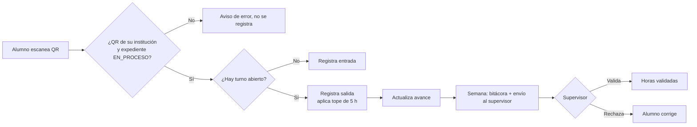
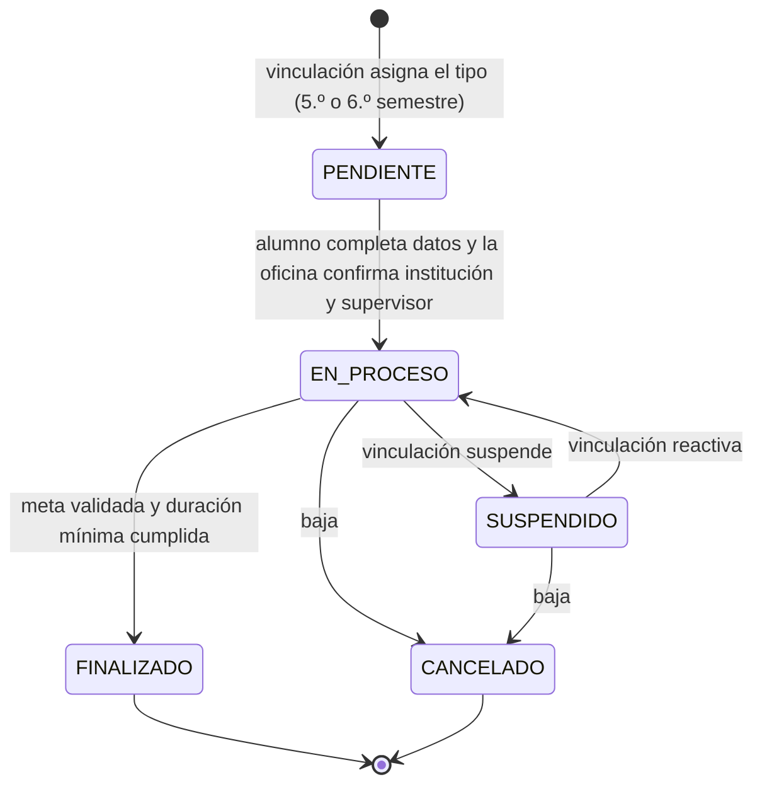
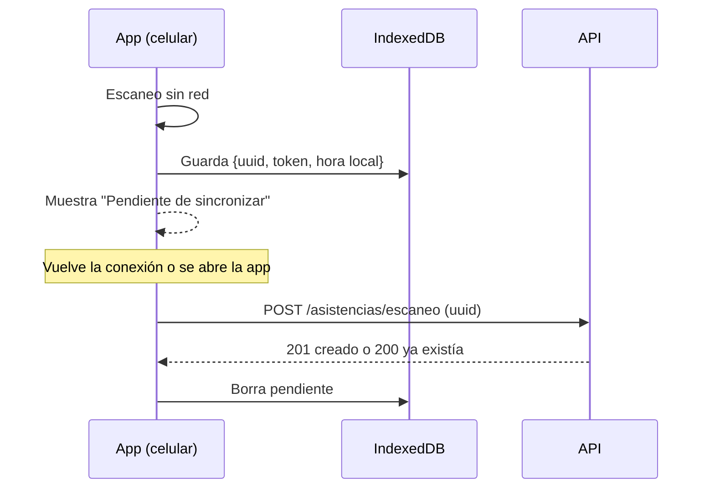

# Especificaciones del MVP — App de Servicio Social y Prácticas Profesionales

| Campo | Valor |
| --- | --- |
| Versión | 0.2 (borrador para revisión) |
| Fecha | 29 de octubre de 2026 |
| Plantel | CBTIS 258, General Escobedo, N. L. |
| Fuentes | Entrevista a vinculación (1 respuesta), entrevista a alumnos (11 respuestas), reglas de servicio social confirmadas y 4 formatos de Edumedia (solicitud y carta de presentación de prácticas; FSS1 y FSS3 de servicio social) |
| Cambios en v0.2 | Reglas de servicio social, asignación del tipo por vinculación, dos oficinas responsables, campos tomados de Edumedia, validación en lote |
| Stack | PostgreSQL · Express · React · Node · TypeScript · Prisma (PWA) |
| Despliegue | Frontend en Vercel · API y base de datos en Railway |

---

## 1. Resumen

PWA (primero para celular, también usable en escritorio) para que los alumnos registren su asistencia de servicio social y prácticas profesionales escaneando un código QR en la institución. La app calcula las horas, muestra el avance y la fecha estimada de término, y permite que el supervisor valide las horas cada semana. Vinculación administra el catálogo de instituciones y da seguimiento a los alumnos.

En 5.º semestre vinculación asigna a cada alumno servicio social o prácticas; en 6.º semestre hace el otro. La app lleva los dos expedientes del alumno a lo largo de ambos semestres.

**Objetivo del MVP:** piloto con la carrera de **Programación**, para comprobar que el registro con QR y el conteo automático son más rápidos y confiables que la libreta o la hoja de papel.

---

## 2. Hallazgos de las entrevistas

### 2.1 Vinculación

| Tema | Respuesta | Impacto en el diseño |
| --- | --- | --- |
| Formatos oficiales | Ya se generan en **Edumedia** (hojas de inicio y cierre, carta de presentación), se sellan y firma la directora y el supervisor; vinculación los resguarda | **La app no debe duplicar los formatos de Edumedia.** Su aporte es el control de horas y la bitácora de actividades |
| Reportes | Se enfocan sobre todo en las **actividades realizadas** | La bitácora de actividades pasa a ser parte central del MVP |
| Formato generado por computadora | Sí lo aceptan, firmado a mano | Reporte de horas y actividades en PDF, listo para firma |
| Volumen | 8 grupos, aproximadamente 400 alumnos por semestre | Dimensionar para ~400 alumnos activos; panel con filtros por grupo |
| Requisito para iniciar | Estar en 5.º semestre (servicio y prácticas) | Regla de elegibilidad por semestre |
| Duración | 3 meses o lo que dure el semestre | Aplica a prácticas; servicio social tiene su propia regla (ver 2.4) |
| Máximo de horas | 5 horas por día | Tope diario de horas acreditables |
| Fines de semana | Sí cuentan, igual que entre semana | No se excluyen días al calcular |
| Servicio y prácticas simultáneos | No al mismo tiempo; en la misma institución sí | Un solo expediente activo por alumno |
| Cambio de institución | Se revisa caso por caso; las horas pueden conservarse | Transferencia decidida por vinculación, con motivo |
| Casos especiales | Suspensiones | Estado `SUSPENDIDO` |
| Instituciones | ~300 empresas e instituciones; se actualizan; a veces los alumnos traen los datos | Importación desde Excel indispensable; alta rápida |
| Datos que guardan | Nombre de la institución o empresa, RFC, dirección, giro, nombre del director, representante o gerente, contacto | Campos del catálogo |
| Cupo | Sí es limitado; se enteran porque la institución lo avisa | Campo de cupo y disponibilidad, editable por vinculación |
| Qué preguntan los alumnos | Cercanía y horario | Filtros por zona y horario |
| Contacto fijo | Sí hay un contacto por institución | Supervisor asociado a la institución |
| Verificación de asistencia | Vinculación no da seguimiento; solo la empresa | El QR y la validación semanal llenan este hueco |
| QR en la institución | "Creo que sí" | Confirmar con cada institución en el piloto |
| Supervisores con correo y validación semanal por enlace | Sí / "creo que sí" | Validación semanal por enlace mágico |
| Registros falsos | Sí, pero muy pocos | Antifraude ligero: QR + validación del supervisor |
| Responsable de datos personales | El departamento de vinculación | Aviso de privacidad a cargo de vinculación |
| Piloto | Carrera de Programación | Grupo piloto |
| Usuaria de vinculación | Mtra. Delfina | Primer usuario administrador (se suma la Ing. Stephany Zúñiga, de Servicio Social) |
| Autorización | La Mtra. Delfina informa a la directora, o la directora autoriza directamente | Presentar el piloto a dirección |
| Otros planteles | "Podría ser" | Diseño preparado para varios planteles, sin implementarlo en el MVP |
| Recomendación | Entrevistar a la persona de servicio social | Reglas de servicio social confirmadas en v0.2 (ver 2.4) |

### 2.2 Alumnos (11 respuestas)

**Perfil:** todos de 5.º semestre; 10 del turno vespertino y 1 del matutino. Carreras: Logística (4), Programación (3), Contabilidad (2), Hospedaje (1) y Alimentos y Bebidas (1). Siete hacen servicio social y tres prácticas; una respuesta no lo especifica.

| Pregunta | Resultado | Impacto en el diseño |
| --- | --- | --- |
| Criterio para elegir institución | Cercanía 8 · horario 2 · recomendación 1 | Filtro por municipio y colonia como filtro principal |
| Usaron las listas de vinculación | Sí 7 · no 4 | El catálogo digital tiene demanda real |
| Información que faltó | Si hay cupo o si siguen aceptando; números de contacto | Mostrar cupo disponible y teléfono |
| Cómo registran hoy | Libreta, hoja de la empresa, huella digital, lista de control; firman distintas personas y a veces nadie | No hay un registro estándar: confirma el problema |
| Llevan su propia cuenta | Sí 8 · no 3 (libreta, hoja, calendario, celular) | Hay disposición a registrar |
| Saben cuántas horas llevan y cuándo terminan | Solo 2 con certeza | **El avance debe ser la pantalla principal** |
| Lo más molesto | Contar y sumar horas a mano | Cálculo automático, sin captura manual |
| Errores | Olvidar registrar (1), diferencia de horas (2) | Recordatorios y corrección de turnos |
| Celular | Android 6 · iPhone 5; todas las cámaras escanean bien | Probar la PWA en Safari de iOS y en Chrome de Android |
| Conexión | 10 tienen datos móviles; 2 sin señal en su institución; 3 se han quedado sin internet al llegar o salir | **Registro sin conexión mínimo dentro del MVP** |
| Lo usarían a diario | Sí 9 · tal vez 2 | Buena adopción esperada |
| Qué ver primero | Conteo de horas, barra o gráfica de porcentaje | Pantalla de inicio con progreso |
| Recordatorio de salida | Sí 10 · no 1 | Recordatorios dentro del MVP |
| Descargar formatos llenos | Sí 11 | Reporte en PDF |
| Utilidad (1 a 5) | Promedio 4.8 (nueve 5 y dos 4) | Validación fuerte de la idea |
| Qué agregarían | Notificaciones de pendientes, alarma | Recordatorios configurables |
| Participarían en el piloto | Sí 10 · no 1 | |

### 2.3 Cambios respecto al plan original

1. **Formatos oficiales:** ya los genera Edumedia. El MVP genera un **reporte de horas y actividades** que complementa los formatos; no los reemplaza.
2. **Recordatorios:** pasan de fase posterior al MVP, porque los alumnos los pidieron casi por unanimidad.
3. **Registro sin conexión:** pasa a ser una versión mínima en el MVP, porque 3 de 11 alumnos han tenido problemas de conexión.
4. **Bitácora de actividades:** pasa a ser obligatoria, porque vinculación se enfoca en las actividades.
5. **Catálogo:** agrega cupo disponible, giro, RFC y representante; los filtros principales son zona y horario.
6. **Reglas nuevas:** máximo 5 horas por día, 5.º semestre, no simultaneidad y estado de suspensión.

### 2.4 Reglas de servicio social y formatos de Edumedia (v0.2)

**Reglas confirmadas**

| Tema | Servicio social | Prácticas profesionales |
| --- | --- | --- |
| Horas | 480 | 240 (los formatos dicen "mínimo 240") |
| Duración | Máximo 6 meses para terminar (ver nota) | Periodo de unos 3 meses (ejemplo: 11 de agosto a 11 de noviembre) |
| Requisito | 5.º semestre | 5.º semestre |
| Asignación | Vinculación asigna el tipo en 5.º; en 6.º se alterna | Igual |
| Oficina responsable | Oficina de Servicio Social y Titulación | Oficina de Prácticas Profesionales |
| Horario | No aparece en el formato | El formato fija días y horario (ejemplo: lunes a viernes de 08:00 a 12:00) |

> **Nota — discrepancia por resolver:** la carta de presentación FSS3 dice *"480 horas durante el periodo mínimo de seis meses y máximo de dos años"*, pero la regla confirmada es *máximo 6 meses*. El MVP deja ambos límites configurables (mínimo y máximo en meses) y usa por ahora la regla confirmada. Hay que aclarar con la Oficina de Servicio Social cuál aplica.

**Qué muestran los formatos de Edumedia**

| Hallazgo | Impacto en el diseño |
| --- | --- |
| Hay dos oficinas con formatos distintos: Prácticas (jefa: Mtra. Delfina Hernández Mendoza) y Servicio Social y Titulación (jefa: Ing. Stephany Zúñiga Regino) | Usuarios de vinculación con alcance por tipo de programa |
| El número de control (14 dígitos) identifica al alumno | Es la "matrícula" de la app |
| Datos de la institución en prácticas: nombre, correo, teléfono, giro, RFC y dirección desglosada (calle, número interior y exterior, colonia, C. P., ciudad, municipio, estado) | Dirección estructurada en el catálogo; facilita filtrar por municipio y colonia |
| Datos del jefe inmediato: título, nombre, apellidos, teléfono, extensión, puesto, correo y departamento | Ampliar la entidad Supervisor |
| La solicitud de prácticas incluye periodo de inicio y término, y hora de entrada y salida | El expediente guarda el periodo y el horario pactado |
| Servicio social registra programa, subprograma, actividad, modalidad (individual) y área (urbana), además de la dependencia | Campos opcionales en el expediente de servicio social |
| Los formatos incluyen CURP, edad, sexo, servicio médico y número de afiliación | **La app no guarda esos datos:** ya están en Edumedia y no se necesitan para contar horas |
| En los ejemplos hay datos incompletos: "FECHA NO REGISTRADA, FAVOR DE MODIFICAR", fechas `0000-00-00`, nombre de empresa y domicilio vacíos | La app puede aportar la fecha real de inicio, el periodo y la institución; exportarlos ayudaría a completar Edumedia |
| Los dos ejemplos son de alumnos que hacen su servicio o práctica en el propio plantel (Departamento de Escolares) | El plantel también es una institución del catálogo; una misma jefa supervisa a varios alumnos → **validación en lote** |

---

## 3. Alcance

Prioridad: **M** = debe tener, **S** = debería tener, **C** = puede esperar.

### Dentro del MVP

| ID | Funcionalidad | Prioridad |
| --- | --- | --- |
| F-01 | Activación de cuenta con matrícula e inicio de sesión | M |
| F-02 | Importación de alumnos e instituciones desde Excel o CSV | M |
| F-03 | Catálogo de instituciones con filtros | M |
| F-04 | Expediente de servicio o prácticas | M |
| F-05 | Registro de entrada y salida con QR | M |
| F-06 | Avance: horas, porcentaje, faltantes, fecha estimada | M |
| F-07 | Bitácora de actividades semanal | M |
| F-08 | Validación semanal por el supervisor mediante enlace | M |
| F-09 | Panel de vinculación con exportación a Excel | M |
| F-10 | Reporte de horas y actividades en PDF | M |
| F-11 | Recordatorio de salida y de bitácora pendiente | S |
| F-12 | Registro sin conexión con sincronización posterior | S |
| F-13 | Registro de auditoría de cambios | M |

### Fuera del MVP

- Integración automática con Edumedia.
- Postulación en línea a instituciones.
- Carga de documentos escaneados.
- Mapa con distancia desde la casa del alumno.
- QR rotativo.
- Varios planteles (el modelo de datos ya lo contempla).

---

## 4. Roles y permisos

| Acción | Alumno | Vinculación | Supervisor (sin cuenta) | Administrador |
| --- | --- | --- | --- | --- |
| Ver catálogo de instituciones | ✔ | ✔ | — | ✔ |
| Crear, editar e importar instituciones | — | ✔ | — | ✔ |
| Importar alumnos | — | ✔ | — | ✔ |
| Asignar el tipo de programa (servicio o prácticas) | — | ✔ | — | ✔ |
| Completar su expediente (institución, supervisor, inicio) | ✔ (solo el tipo asignado) | ✔ | — | ✔ |
| Registrar entrada y salida | ✔ (solo el suyo) | — | — | — |
| Escribir la bitácora | ✔ | — | — | — |
| Validar o rechazar una semana | — | ✔ (casos especiales) | ✔ (solo sus alumnos, por enlace) | ✔ |
| Corregir registros | Solicita | ✔ | — | ✔ |
| Suspender, transferir o cancelar expediente | — | ✔ | — | ✔ |
| Ver avance de todos los alumnos | — | ✔ | — | ✔ |
| Descargar PDF | ✔ (el suyo) | ✔ | — | ✔ |
| Gestionar usuarios de vinculación | — | — | — | ✔ |
| Ver la auditoría | — | ✔ | — | ✔ |

"Vinculación" se divide en dos alcances (RN-03b): **Oficina de Prácticas Profesionales** y **Oficina de Servicio Social y Titulación**. Cada una ve y administra solo los expedientes de su tipo. El catálogo de instituciones es compartido.

---

## 5. Reglas de negocio

| ID | Regla | Fuente | Estado |
| --- | --- | --- | --- |
| RN-01 | Solo los alumnos de **5.º semestre o superior** pueden tener un expediente | Vinculación y servicio social | Confirmada |
| RN-02 | Meta de horas: **480 para servicio social** y **240 para prácticas**. Es configurable | Servicio social y formatos | Confirmada |
| RN-03 | Un alumno no puede tener servicio y prácticas en proceso al mismo tiempo. Puede hacer ambos en la misma institución en periodos distintos | Vinculación | Confirmada |
| RN-03a | **El tipo de programa lo asigna vinculación**, no el alumno. En 5.º semestre se asigna servicio o prácticas, y en 6.º el otro | Servicio social | Confirmada |
| RN-03b | Cada usuario de vinculación administra solo los expedientes de su oficina (Prácticas o Servicio Social); el administrador ve ambos | Formatos de Edumedia | Confirmada |
| RN-04 | Máximo **6 h 30 min (390 minutos) acreditables por día** por alumno. Si un turno las supera, el excedente se registra pero no se acredita, y se avisa al alumno. *(Antes 5 horas; cambiado por decisión de la responsable del proyecto el 2026-11-11.)* | Vinculación | Confirmada |
| RN-05 | Todos los días cuentan, incluidos sábados y domingos | Vinculación | Confirmada |
| RN-06 | Duración configurable por tipo, con mínimo y máximo en meses. Valores iniciales: **servicio social, máximo 6 meses**; **prácticas, el periodo de inicio y término del expediente** (unos 3 meses). El expediente se finaliza al cumplir las horas validadas | Servicio social, vinculación y formatos | Confirmada, con la discrepancia de 2.4 por resolver |
| RN-06a | Si con el ritmo actual la fecha estimada de término pasa el máximo permitido o el fin del periodo, el alumno y vinculación ven una alerta "en riesgo" | Diseño | — |
| RN-06b | En prácticas, el expediente guarda el horario pactado (días y horas). Los turnos fuera de ese horario se aceptan, pero se marcan para que el supervisor los revise | Formatos de Edumedia | Ajustable |
| RN-07 | Solo puede haber un turno abierto por expediente. Un nuevo escaneo con turno abierto lo cierra | Diseño | — |
| RN-08 | Un turno sin salida se cierra automáticamente a las 23:59 con estado `INCOMPLETA` y 0 horas acreditadas, hasta que se corrija | Diseño | — |
| RN-09 | Un turno debe durar al menos 15 minutos para acreditarse (evita doble escaneo accidental) | Diseño | Ajustable |
| RN-10 | El QR solo es válido para la institución del expediente activo del alumno | Diseño | — |
| RN-11 | El avance muestra **horas registradas** y **horas validadas**. Solo las validadas cuentan para finalizar | Diseño | — |
| RN-12 | Cambio de institución: vinculación decide en cada caso si se conservan las horas. Se guardan las horas transferidas y el motivo | Vinculación | Confirmada |
| RN-13 | Un expediente `SUSPENDIDO` no permite registrar asistencia | Vinculación | Confirmada |
| RN-14 | Los registros hechos sin conexión usan la hora del dispositivo, se marcan como "sin conexión" y se aceptan si llegan al servidor en menos de 72 horas | Diseño | Ajustable |
| RN-15 | Todas las horas se guardan en UTC con zona horaria y se muestran en hora de Monterrey (`America/Monterrey`) | Diseño | — |
| RN-16 | Fecha estimada de término = hoy + (horas faltantes ÷ promedio diario de los últimos 28 días). Con menos de 5 días registrados se muestra "aún sin datos suficientes" | Diseño | — |
| RN-17 | Una semana solo puede enviarse a validación si tiene bitácora de actividades | Vinculación (enfoque en actividades) | — |
| RN-18 | Si el supervisor no valida en 7 días, la semana queda visible para vinculación como pendiente | Diseño | — |

---

## 6. Requerimientos funcionales

### M1. Cuentas y acceso

**RF-01 Importación de alumnos.** Vinculación sube un Excel o CSV con: número de control, nombre, apellido paterno, apellido materno, carrera, semestre, grupo, turno y **tipo asignado** (servicio social o prácticas). Al importar se crea el expediente en estado `PENDIENTE` con el tipo asignado.
- La plantilla usa los mismos nombres de columna que Edumedia para poder copiar y pegar desde su exportación (confirmar si Edumedia exporta a Excel).
- Al pasar a 6.º semestre, una acción "Asignar siguiente programa" crea el expediente del tipo contrario para los alumnos que finalizaron el primero.
- Se descarga una plantilla con las columnas exactas.
- Vista previa con errores por fila (matrícula repetida, carrera desconocida, semestre inválido) antes de confirmar.
- Una matrícula existente se actualiza; no se duplica.

**RF-02 Activación de cuenta.** El alumno entra con su matrícula, confirma su nombre y crea una contraseña.
- Si la matrícula no está precargada, se muestra: "Tu matrícula no está registrada; acude a vinculación".
- El correo es opcional.

**RF-03 Inicio de sesión** con matrícula (alumno) o correo (vinculación) y contraseña. La sesión usa una cookie httpOnly y dura 30 días en el celular.

**RF-04 Restablecer contraseña.** Vinculación genera una contraseña temporal; el alumno la cambia al entrar.

### M2. Catálogo de instituciones

**RF-05 Ficha de institución** con los campos de la sección 8.

**RF-06 Búsqueda y filtros:** texto (nombre o giro), municipio, colonia, carrera, turno o horario, tipo (servicio o prácticas) y "con cupo disponible".
- Si el alumno no tiene expediente, el catálogo se filtra de inicio por su carrera y turno.
- Cada tarjeta muestra nombre, giro, municipio, horario, cupo y botón para llamar.

**RF-07 Importación de instituciones** desde Excel o CSV (~300 registros), con plantilla, vista previa y detección de duplicados por RFC o nombre.

**RF-08 Alta y edición manual.** Vinculación puede marcar una institución como inactiva o "sin cupo".

**RF-09 Supervisores.** Cada institución tiene uno o más supervisores (título, nombre, apellidos, puesto, departamento, correo, teléfono y extensión, como en la solicitud de Edumedia).

### M3. Expediente

**RF-10 Completar expediente.** El expediente ya existe con el tipo asignado por vinculación (RF-01). El alumno completa: institución, departamento o área, supervisor (jefe inmediato), fecha de inicio y, en prácticas, fecha de término y horario pactado (días, hora de entrada y de salida). En servicio social puede capturar programa y subprograma (opcional).
- Si su supervisor no existe, lo captura y queda pendiente de revisión por la oficina correspondiente.
- Valida RN-01, RN-03 y RN-06.
- Pasa a `EN_PROCESO` cuando la oficina confirma institución y supervisor; mientras tanto sigue `PENDIENTE`.

**RF-11 Estados** (ver diagrama en la sección 11): `PENDIENTE`, `EN_PROCESO`, `SUSPENDIDO`, `FINALIZADO`, `CANCELADO`.

**RF-12 Acciones de vinculación:** suspender o reactivar, cancelar (baja) y transferir de institución conservando o no las horas (RN-12). Toda acción pide un motivo y queda en la auditoría.

### M4. Asistencia con QR

**RF-13 QR por institución.** Vinculación genera e imprime un QR por institución. Contiene una URL con un token aleatorio, por ejemplo `https://app.dominio.mx/s/{token}`. Se puede regenerar si se filtra.

**RF-14 Escaneo.** Desde el botón "Registrar" de la app se abre la cámara. Si el QR se escanea con la cámara del teléfono, la URL abre la app.
- Sin turno abierto → registra la **entrada**.
- Con turno abierto → registra la **salida**, calcula los minutos y aplica RN-04 y RN-09.
- Se muestra confirmación con la hora y las horas del día.

**RF-15 Respaldo sin cámara.** Debajo del QR impreso hay un código corto de 6 caracteres que se puede escribir a mano.

**RF-16 Registro sin conexión (S).** Si no hay red, el registro se guarda en el dispositivo (IndexedDB) con un UUID y la hora local, y se envía al recuperar conexión o al abrir la app (RN-14). La pantalla muestra "Pendiente de sincronizar".

**RF-17 Solicitud de corrección.** Para un turno `INCOMPLETA` u otro error, el alumno propone la hora correcta con un motivo. Vinculación la aprueba o rechaza.

### M5. Avance (pantalla de inicio del alumno)

**RF-18** La pantalla de inicio muestra, en este orden:
1. Barra de progreso circular o lineal con el porcentaje validado.
2. Horas validadas / meta, horas registradas aún sin validar y horas faltantes.
3. Fecha estimada de término (RN-16).
4. Estado del turno de hoy (abierto desde las HH:MM, o sin registro) y botón "Registrar".
5. Pendientes: bitácora de la semana, correcciones.

**RF-19 Historial** por semana: días, entradas, salidas, horas y estado de validación.

### M6. Bitácora y validación semanal

**RF-20 Bitácora.** Cada semana (lunes a domingo) el alumno escribe sus actividades (mínimo 50 caracteres). Puede editarla hasta que la envía.

**RF-21 Envío al supervisor.** Al cerrar la semana, o cuando el alumno la envía, el supervisor recibe un correo con un enlace válido por 14 días. El enlace muestra los turnos y la bitácora, con botones **Validar** y **Rechazar** (este último con comentario obligatorio). No requiere cuenta.

**RF-21a Validación en lote.** Si un supervisor tiene varios alumnos (por ejemplo, la jefa de Escolares del propio plantel), recibe **un solo correo semanal** con todas sus semanas pendientes y puede validarlas todas a la vez o una por una.

**RF-22** Una semana rechazada vuelve al alumno para corregir. Vinculación puede validar en nombre del supervisor en casos especiales, y eso queda en la auditoría.

### M7. Panel de vinculación

**RF-23 Tabla de alumnos** de la oficina del usuario (RN-03b), con filtros por carrera, semestre, grupo, turno, estado, institución y "en riesgo" (RN-06a). Columnas: alumno, institución, horas validadas / meta, porcentaje, último registro y semanas pendientes de validar.

**RF-24 Alertas:** alumnos sin registros en 7 días, semanas sin validar por más de 7 días, turnos incompletos y supervisores pendientes de revisión.

**RF-25 Detalle del alumno:** expediente, historial, bitácoras, acciones (RF-12) y auditoría.

**RF-26 Exportación a Excel** de la tabla filtrada (para informes a dirección). Incluye una exportación "para Edumedia" con número de control, institución, RFC, periodo de inicio y término, horario y supervisor, para completar los datos que hoy aparecen vacíos en los formatos.

### M8. Reportes

**RF-27 PDF de horas y actividades** por expediente y rango de fechas: datos del alumno y la institución, tabla de turnos validados, bitácoras, total de horas y espacios para firma del supervisor y de vinculación. Tamaño carta.

### M9. Recordatorios (S)

**RF-28** Notificación push (PWA) y aviso dentro de la app:
- Turno abierto después de 6 horas: "¿Olvidaste registrar tu salida?".
- Domingo a las 18:00: "Escribe tu bitácora de la semana".
- En iPhone las notificaciones push solo funcionan con la app instalada en la pantalla de inicio (iOS 16.4 o posterior); la app muestra cómo instalarla.

### M10. Auditoría

**RF-29** Se registran quién, qué, cuándo, valor anterior y valor nuevo para: correcciones de turnos, cambios de estado del expediente, validaciones, importaciones y ediciones de instituciones.

---

## 7. Requerimientos no funcionales

| ID | Requerimiento |
| --- | --- |
| RNF-01 | PWA instalable, diseñada primero para celular (pantalla de 360 px de ancho) y adaptable a escritorio |
| RNF-02 | Compatible con Safari en iOS 16.4 o posterior y Chrome en Android 10 o posterior |
| RNF-03 | El registro de entrada o salida tarda menos de 10 segundos desde abrir la app, con conexión móvil |
| RNF-04 | Soporta 400 alumnos activos y picos de 100 escaneos en 10 minutos (cambio de turno) |
| RNF-05 | El frontend y la API comparten dominio (subdominios propios o redireccionamiento `/api` desde Vercel) para que Safari no bloquee las cookies |
| RNF-06 | Contraseñas con argon2; HTTPS; límite de intentos de inicio de sesión; tokens de QR y de enlaces de validación aleatorios y guardados con hash |
| RNF-07 | Aviso de privacidad visible al activar la cuenta; datos mínimos necesarios; responsable: departamento de vinculación. **No se guardan CURP, edad, sexo, servicio médico ni número de afiliación**: ya están en Edumedia y no se necesitan para contar horas (muchos alumnos son menores de edad) |
| RNF-08 | Respaldos automáticos diarios de la base de datos |
| RNF-09 | Interfaz en español, legible con texto grande y contraste suficiente (WCAG 2.1 AA) |
| RNF-10 | Modelo de datos con `plantelId` en las tablas principales para permitir varios planteles en el futuro |

---

## 8. Modelo de datos

### 8.1 Entidades

| Entidad | Propósito |
| --- | --- |
| Plantel | Escuela (una sola en el MVP) |
| Usuario | Credenciales y rol |
| Alumno | Datos escolares del alumno |
| Carrera | Catálogo de carreras |
| Institucion | Empresa o institución receptora |
| InstitucionCarrera | Carreras que acepta cada institución |
| Supervisor | Contacto que valida las horas |
| Expediente | Un servicio o una práctica de un alumno |
| Asistencia | Un turno: entrada y salida |
| SemanaBitacora | Actividades de una semana y su validación |
| SolicitudCorreccion | Cambio propuesto a un turno |
| AuditLog | Registro de cambios |

### 8.2 Esquema Prisma (propuesta inicial)

```prisma
enum Rol              { ALUMNO VINCULACION ADMIN }
enum Turno            { MATUTINO VESPERTINO }
enum TipoPrograma     { SERVICIO_SOCIAL PRACTICAS }
enum EstadoExpediente { PENDIENTE EN_PROCESO SUSPENDIDO FINALIZADO CANCELADO }
enum EstadoAsistencia { ABIERTA CERRADA INCOMPLETA }
enum EstadoValidacion { BORRADOR ENVIADA VALIDADA RECHAZADA }
enum EstadoSolicitud  { PENDIENTE APROBADA RECHAZADA }

model Plantel {
  id     String @id @default(uuid())
  nombre String
}

model Usuario {
  id           String   @id @default(uuid())
  plantelId    String
  rol          Rol
  matricula    String?  @unique
  email        String?  @unique
  passwordHash String?
  oficina      TipoPrograma? // alcance de un usuario de VINCULACION; null = ambas
  debeCambiar  Boolean  @default(false)
  activo       Boolean  @default(true)
  creadoEn     DateTime @default(now())
  alumno       Alumno?
}

model Carrera {
  id     String @id @default(uuid())
  nombre String @unique
}

model Alumno {
  id          String       @id @default(uuid())
  usuarioId   String       @unique
  usuario     Usuario      @relation(fields: [usuarioId], references: [id])
  nombre          String
  apellidoPaterno String
  apellidoMaterno String?
  // Sin CURP, edad, sexo ni número de afiliación: viven en Edumedia
  carreraId   String
  carrera     Carrera      @relation(fields: [carreraId], references: [id])
  semestre    Int
  grupo       String
  turno       Turno
  expedientes Expediente[]
}

model Institucion {
  id               String               @id @default(uuid())
  plantelId        String
  nombre           String
  rfc              String?
  giro             String?
  calle            String
  numExterior      String?
  numInterior      String?
  colonia          String?
  codigoPostal     String?
  municipio        String
  estado           String               @default("Nuevo León")
  esPlantel        Boolean              @default(false) // el propio CBTIS como institución
  telefono         String?
  correo           String?
  representante    String?              // director, gerente o representante
  horarioAtencion  String?
  turnos           Turno[]
  aceptaServicio   Boolean              @default(true)
  aceptaPracticas  Boolean              @default(true)
  cupo             Int?                 // null = sin dato
  activa           Boolean              @default(true)
  qrTokenHash      String               @unique
  codigoCorto      String               @unique
  carreras         InstitucionCarrera[]
  supervisores     Supervisor[]
  actualizadoEn    DateTime             @updatedAt

  @@unique([plantelId, rfc])
}

model InstitucionCarrera {
  institucionId String
  carreraId     String
  institucion   Institucion @relation(fields: [institucionId], references: [id])
  carrera       Carrera     @relation(fields: [carreraId], references: [id])

  @@id([institucionId, carreraId])
}

model Supervisor {
  id            String      @id @default(uuid())
  institucionId String
  institucion   Institucion @relation(fields: [institucionId], references: [id])
  titulo          String?     // Lic., Ing., Mtra.
  nombre          String
  apellidoPaterno String
  apellidoMaterno String?
  puesto          String?
  departamento    String?
  correo          String
  telefono        String?
  extension       String?
  confirmado      Boolean     @default(false)
}

model Expediente {
  id                String           @id @default(uuid())
  alumnoId          String
  alumno            Alumno           @relation(fields: [alumnoId], references: [id])
  tipo              TipoPrograma
  semestre          Int              // 5 o 6
  institucionId     String?          // null hasta que el alumno lo completa
  supervisorId      String?
  departamento      String?
  fechaInicio       DateTime?        @db.Date
  fechaTermino      DateTime?        @db.Date // prácticas: periodo pactado
  diasPactados      Int[]            // 1 = lunes … 7 = domingo
  horaEntrada       String?          // "08:00"
  horaSalida        String?          // "12:00"
  programa          String?          // servicio social: programa
  subprograma       String?          // servicio social: subprograma
  metaHoras         Int              // 480 o 240
  minutosTransferidos Int            @default(0)
  motivoTransferencia String?
  estado            EstadoExpediente @default(PENDIENTE)
  creadoEn          DateTime         @default(now())
  asistencias       Asistencia[]
  semanas           SemanaBitacora[]
}

model Asistencia {
  id                   String           @id      // UUID generado en el cliente (idempotencia)
  expedienteId         String
  expediente           Expediente       @relation(fields: [expedienteId], references: [id])
  entrada              DateTime         @db.Timestamptz
  salida               DateTime?        @db.Timestamptz
  minutosAcreditables  Int?
  estado               EstadoAsistencia @default(ABIERTA)
  sinConexion          Boolean          @default(false)
  recibidoEn           DateTime         @default(now())
  semanaId             String?
}

model SemanaBitacora {
  id              String           @id @default(uuid())
  expedienteId    String
  expediente      Expediente       @relation(fields: [expedienteId], references: [id])
  semanaInicio    DateTime         @db.Date   // lunes
  actividades     String?
  estado          EstadoValidacion @default(BORRADOR)
  tokenHash       String?          @unique
  tokenExpira     DateTime?
  validadoPor     String?          // "supervisor" o id de usuario de vinculación
  validadoEn      DateTime?
  comentario      String?

  @@unique([expedienteId, semanaInicio])
}

model SolicitudCorreccion {
  id            String          @id @default(uuid())
  asistenciaId  String
  entradaNueva  DateTime        @db.Timestamptz
  salidaNueva   DateTime        @db.Timestamptz
  motivo        String
  estado        EstadoSolicitud @default(PENDIENTE)
  resueltoPor   String?
  creadoEn      DateTime        @default(now())
}

model AuditLog {
  id        String   @id @default(uuid())
  usuarioId String?
  accion    String
  entidad   String
  entidadId String
  antes     Json?
  despues   Json?
  fecha     DateTime @default(now())
}
```

### 8.3 Restricciones en SQL (agregar en la migración)

```sql
-- Sin turnos traslapados en el mismo expediente
CREATE EXTENSION IF NOT EXISTS btree_gist;
ALTER TABLE "Asistencia" ADD CONSTRAINT asistencia_sin_traslape
  EXCLUDE USING gist ("expedienteId" WITH =,
                      tstzrange("entrada", COALESCE("salida", 'infinity')) WITH &&);

-- La salida siempre después de la entrada
ALTER TABLE "Asistencia" ADD CONSTRAINT salida_despues_entrada
  CHECK ("salida" IS NULL OR "salida" > "entrada");

-- Un solo turno abierto por expediente
CREATE UNIQUE INDEX un_turno_abierto
  ON "Asistencia" ("expedienteId") WHERE "estado" = 'ABIERTA';

-- Un solo expediente activo por alumno (RN-03)
CREATE UNIQUE INDEX un_expediente_activo
  ON "Expediente" ("alumnoId")
  WHERE "estado" IN ('PENDIENTE', 'EN_PROCESO', 'SUSPENDIDO');
```

### 8.4 Cálculo de horas

- Minutos del turno = `salida − entrada`; menos de 15 minutos → 0 (RN-09).
- Minutos acreditables del día = `min(suma del día, 390)` (RN-04); el excedente se descuenta del último turno del día.
- Horas validadas = (suma de minutos acreditables en semanas `VALIDADA` + `minutosTransferidos`) ÷ 60.
- El total se calcula con una consulta o vista, no se guarda como columna, para evitar desincronización.

---

## 9. API REST (v1)

| Método | Ruta | Rol | Descripción |
| --- | --- | --- | --- |
| POST | `/api/auth/activar` | Público | Activar cuenta con matrícula |
| POST | `/api/auth/login` | Público | Iniciar sesión |
| POST | `/api/auth/logout` | Sesión | Cerrar sesión |
| GET | `/api/me` | Sesión | Perfil y expediente activo |
| GET | `/api/instituciones` | Sesión | Catálogo con filtros (`q`, `municipio`, `carrera`, `turno`, `tipo`, `conCupo`) |
| GET | `/api/instituciones/:id` | Sesión | Detalle |
| POST/PATCH | `/api/instituciones` · `/:id` | Vinculación | Alta y edición |
| POST | `/api/instituciones/:id/qr` | Vinculación | Generar o regenerar QR (devuelve PDF imprimible) |
| POST | `/api/importaciones/{alumnos\|instituciones}/preview` | Vinculación | Validar archivo y devolver errores por fila |
| POST | `/api/importaciones/{alumnos\|instituciones}/confirmar` | Vinculación | Aplicar importación |
| POST | `/api/expedientes/asignar` | Vinculación | Asignar tipo de programa (individual o en lote; 5.º y 6.º semestre) |
| PATCH | `/api/expedientes/:id` | Alumno dueño / Vinculación | Completar institución, supervisor, periodo y horario |
| POST | `/api/expedientes/:id/confirmar` | Vinculación | Confirmar institución y supervisor → `EN_PROCESO` |
| PATCH | `/api/expedientes/:id/estado` | Vinculación | Suspender, reactivar, cancelar |
| POST | `/api/expedientes/:id/transferir` | Vinculación | Cambio de institución (RN-12) |
| GET | `/api/expedientes/:id/avance` | Alumno dueño / Vinculación | Horas, porcentaje y fecha estimada |
| POST | `/api/asistencias/escaneo` | Alumno | `{ id (uuid), token o codigoCorto, hora, sinConexion }` → registra entrada o salida |
| GET | `/api/asistencias?semana=` | Alumno / Vinculación | Historial |
| POST | `/api/asistencias/:id/correcciones` | Alumno | Solicitar corrección |
| PATCH | `/api/correcciones/:id` | Vinculación | Aprobar o rechazar |
| PUT | `/api/semanas/:id/bitacora` | Alumno | Guardar actividades |
| POST | `/api/semanas/:id/enviar` | Alumno | Enviar a validación |
| GET | `/api/validacion/:token` | Público con token | Ver semana(s) a validar; incluye todas las del supervisor (RF-21a) |
| POST | `/api/validacion/:token` | Público con token | Validar o rechazar |
| GET | `/api/panel/alumnos` | Vinculación | Tabla con filtros y alertas |
| GET | `/api/panel/alumnos.xlsx` | Vinculación | Exportación |
| GET | `/api/panel/edumedia.xlsx` | Vinculación | Exportación con los datos para completar Edumedia (RF-26) |
| GET | `/api/expedientes/:id/reporte.pdf` | Alumno dueño / Vinculación | Reporte de horas y actividades |

El endpoint de escaneo es idempotente: si llega dos veces el mismo `id` (por reintento sin conexión), responde con el registro existente.

---

## 10. Pantallas

### Alumno (celular)
1. **Activar cuenta / Iniciar sesión**
2. **Inicio:** progreso, turno de hoy, botón grande "Registrar" y pendientes (RF-18)
3. **Escáner QR** con opción de código corto
4. **Historial** por semana
5. **Bitácora** de la semana
6. **Instituciones:** buscador, filtros y ficha (si no tiene expediente)
7. **Completar expediente** (tipo ya asignado por vinculación)
8. **Perfil:** datos, instalar la app, notificaciones, cerrar sesión

### Vinculación (escritorio)
1. **Panel:** tabla de alumnos y alertas
2. **Detalle del alumno**
3. **Instituciones:** tabla, alta, edición e impresión de QR
4. **Importaciones** con plantilla y vista previa
5. **Correcciones pendientes**

### Supervisor (enlace, celular o escritorio)
1. **Validar semanas:** lista de sus alumnos con turnos y bitácora; Validar todo / Validar / Rechazar

---

## 11. Flujos

### 11.1 Registro con QR



### 11.2 Estados del expediente



Una transferencia de institución cierra el expediente actual como `CANCELADO` (motivo: transferencia) y abre uno nuevo con `minutosTransferidos`.

### 11.3 Registro sin conexión



---

## 12. Piloto

| Aspecto | Definición |
| --- | --- |
| Grupo | Alumnos de 5.º semestre de Programación, tanto de servicio social como de prácticas, para probar las dos oficinas |
| Usuarias de vinculación | Mtra. Delfina Hernández Mendoza (Prácticas) e Ing. Stephany Zúñiga Regino (Servicio Social) |
| Autorización | Presentar a la directora a través de la Mtra. Delfina |
| Instituciones | Solo las de los alumnos del piloto; confirmar con cada una que acepta el QR impreso |
| Convivencia con el proceso actual | Durante el piloto se mantiene la hoja o libreta en paralelo para comparar |
| Duración sugerida | 4 a 6 semanas |

**Métricas de éxito**

| Métrica | Meta |
| --- | --- |
| Alumnos del piloto que registran al menos 4 días por semana | ≥ 80 % |
| Semanas validadas por el supervisor dentro de 7 días | ≥ 70 % |
| Turnos incompletos (sin salida) | ≤ 10 % |
| Diferencia entre horas de la app y de la hoja en papel | ≤ 2 % |
| Utilidad percibida al final (escala 1 a 5) | ≥ 4.5 |

---

## 13. Preguntas abiertas y supuestos

| # | Pregunta | Por qué importa | Con quién |
| --- | --- | --- | --- |
| 1 | Servicio social: ¿aplica el **máximo de 6 meses** (regla confirmada) o el **mínimo de 6 meses y máximo de 2 años** que dice la carta FSS3? | Define RN-06 y las alertas de riesgo | Ing. Stephany Zúñiga (Servicio Social) |
| 2 | Prácticas: ¿el periodo de inicio y término de la solicitud es obligatorio, o el alumno puede terminar antes si completa las 240 horas? | Define RN-06 | Mtra. Delfina Hernández (Prácticas) |
| 2a | ¿Qué otros formatos se generan después (FSS2, reportes, cartas de terminación) y qué datos piden? Solo se compartieron los de inicio | Define el reporte en PDF y la exportación a Edumedia | Ambas oficinas |
| 2b | ¿Edumedia puede exportar a Excel la lista de alumnos con su tipo asignado? | Simplifica RF-01 | Ambas oficinas |
| 2c | ¿Cuentan los turnos de prácticas fuera del horario pactado (por ejemplo, sábados)? Vinculación dijo que los fines de semana cuentan, pero el formato fija lunes a viernes | Define RN-05 y RN-06b | Mtra. Delfina Hernández |
| 3 | De los ~400 alumnos por semestre, ¿cuántos son de servicio y cuántos de prácticas? | Dimensionar el piloto y el panel | Vinculación |
| 4 | ¿Qué datos del avance podría necesitar Edumedia? ¿Se capturan a mano allí? | Un export compatible ahorraría captura doble | Vinculación |
| 5 | ¿Hay días inhábiles que no deban contar (vacaciones oficiales)? | Hoy se asume que todos los días cuentan | Vinculación |
| 6 | ¿Quién además de vinculación debe ver la información de los alumnos (orientadores, tutores)? | La pregunta quedó sin respuesta; define roles | Vinculación |
| 7 | ¿El plantel tiene un aviso de privacidad redactado que se pueda reutilizar? | RNF-07 | Vinculación y dirección |
| 8 | ¿Cada institución del piloto acepta el QR impreso? | Si alguna no, usar el código corto o validar con el supervisor | Instituciones |
| 9 | Alumnos sin datos móviles ni wifi en su institución (2 de 11): ¿basta con el registro sin conexión? | Confirmar en el piloto | Alumnos |

**Supuestos tomados para avanzar:** servicio social con máximo de 6 meses; prácticas dentro del periodo pactado; todos los días cuentan; turno mínimo de 15 minutos y cierre automático a las 23:59. Todos son configurables.

---

## 14. Plan de trabajo sugerido para el MVP

| Iteración | Entregable |
| --- | --- |
| 1 | Monorepo, base de datos, autenticación, importación de alumnos con tipo asignado, usuarios por oficina |
| 2 | Catálogo e importación de instituciones, generación de QR |
| 3 | Expediente, escaneo, cálculo de horas y pantalla de avance |
| 4 | Bitácora, validación por enlace y correo |
| 5 | Panel de vinculación, exportación a Excel y PDF de reporte |
| 6 | Registro sin conexión, recordatorios, pruebas en iPhone y Android |
| 7 | Piloto con Programación |
