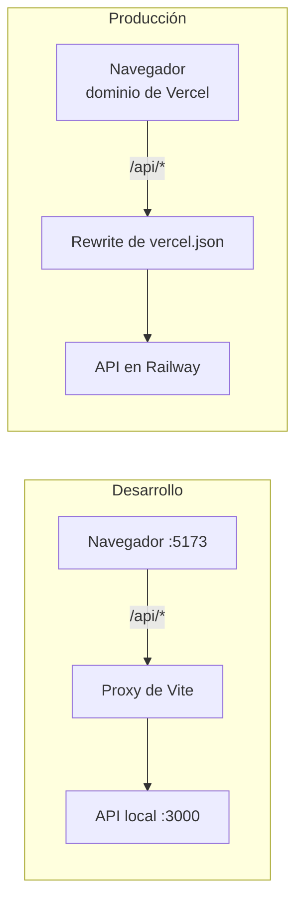

# Frontend — PWA de Praxis

Aplicación web progresiva en **React + Vite + TypeScript**, diseñada primero para celular (360 px) y adaptable a escritorio para el panel de vinculación. Se despliega en Vercel con Root Directory `frontend`.

## Inicio rápido

```bash
cd frontend
pnpm install
pnpm dev        # http://localhost:5173
```

Para que las pantallas reciban datos, levanta también la API (ver [`../backend/README-BACKEND.md`](../backend/README-BACKEND.md)). Vite redirige `/api` a `http://localhost:3000`.

Verifica que el proxy funciona:

```bash
curl http://localhost:5173/api/health
# {"status":"ok"}  ← la respuesta viene de la API, a través de Vite
```

## Requisitos

| Requisito | Versión |
| --- | --- |
| Node | 22 LTS o superior |
| pnpm | 10 |
| API corriendo | Solo para usar la app y para las pruebas de punta a punta; las pruebas unitarias no la necesitan |

No hacen falta variables de entorno: todas las llamadas usan rutas relativas `/api/...`. La URL de Railway vive solo en `vercel.json`.

## Comandos

| Comando | Qué hace |
| --- | --- |
| `pnpm dev` | Servidor de desarrollo en `:5173` con proxy `/api` → `:3000` |
| `pnpm build` | Revisa tipos y genera `dist/` con el service worker |
| `pnpm preview` | Sirve el build en `:4173`, para probar la PWA y el modo sin conexión |
| `pnpm test` | Pruebas unitarias y de componentes (Vitest + MSW) |
| `pnpm test:watch` | Pruebas en modo observación |
| `pnpm test:e2e` | Pruebas de punta a punta con Playwright (requiere la API) |
| `pnpm typecheck` | Revisa tipos |
| `pnpm lint` | ESLint |

## Probar en local

| Qué probar | Cómo |
| --- | --- |
| La app carga | Abre `http://localhost:5173` → redirige a **Iniciar sesión** |
| Rutas por rol | `/alumno`, `/vinculacion`, `/validar/cualquier-token` |
| Página no encontrada | `http://localhost:5173/no-existe` |
| Proxy a la API | `http://localhost:5173/api/health` → `{"status":"ok"}` |
| PWA instalable | `pnpm build && pnpm preview`, luego en Chrome: DevTools → Application → Manifest / Service Workers |
| Vista de celular | DevTools → Toggle device toolbar → iPhone o Pixel |

### Probar desde tu celular en la misma red

```bash
pnpm dev --host
```

Abre en el celular la URL `Network:` que imprime Vite (por ejemplo `http://192.168.1.50:5173`). La cámara para el QR exige HTTPS, salvo en `localhost`; para probar el escáner en el teléfono usa el despliegue de Vercel o un túnel HTTPS.

### Pruebas de punta a punta

```bash
pnpm exec playwright install   # solo la primera vez: descarga los navegadores
pnpm test:e2e                  # corre en viewport de iPhone 13 y Pixel 7
```

## Cómo se conecta con la API



En los dos casos el navegador ve **el mismo origen**, así la cookie de sesión funciona también en Safari de iPhone (RNF-05).

`src/lib/api.ts` es el único punto de salida hacia la API:

- Envía siempre `credentials: 'include'` (cookie de sesión).
- Rechaza URLs absolutas, para que nadie llame a Railway por accidente.
- Convierte la respuesta de error `{ error: { code, message } }` en un `ApiError` con el mensaje en español, listo para mostrarse.

## Estructura

```
frontend/
├── vercel.json            # rewrite /api → Railway y fallback a index.html
├── vite.config.ts         # React, Tailwind, PWA, proxy y Vitest
├── components.json        # configuración de shadcn/ui
├── public/                # íconos de la PWA
├── src/
│   ├── main.tsx           # QueryClient + Router
│   ├── router.tsx         # rutas por rol
│   ├── index.css          # Tailwind y tema de shadcn
│   ├── lib/               # api, auth, utils, formato de fechas
│   ├── components/ui/     # componentes de shadcn/ui
│   ├── features/<feature>/ # pantallas por funcionalidad (avance, escaneo, panel...)
│   └── offline/           # cola de escaneos en IndexedDB (RF-16)
├── test/                  # setup y handlers de MSW
└── e2e/                   # pruebas de Playwright
```

Agregar un componente de shadcn/ui:

```bash
pnpm dlx shadcn@latest add card dialog input
```

## Reglas de la interfaz

- La pantalla de inicio del alumno es su **avance** (RF-18); el botón "Registrar" es grande y siempre visible.
- Textos en español, claros y cortos; contraste y tamaño según WCAG 2.1 AA (RNF-09).
- El frontend **nunca** calcula horas ni decide reglas de negocio: muestra lo que devuelve la API.
- Las fechas se muestran en `America/Monterrey`.

## Pruebas

- **Vitest + React Testing Library** para componentes y hooks, con **MSW** simulando la API (`test/msw/handlers.ts`).
- Cada pantalla prueba sus estados: cargando, error, vacío y con datos.
- La cola sin conexión se prueba con `fake-indexeddb`.
- **Playwright** cubre los flujos críticos: activar cuenta, escanear entrada y salida, escribir la bitácora y validar como supervisor.

## Problemas comunes

| Síntoma | Solución |
| --- | --- |
| `/api/...` responde 500 o `ECONNREFUSED` en la consola de Vite | La API no está corriendo en `:3000` |
| El service worker sirve una versión vieja | DevTools → Application → Service Workers → *Unregister*, o recarga forzada |
| La cámara no abre en el celular | Necesita HTTPS; usa Vercel o un túnel |
| `EPERM ... symlink` al instalar | Por eso `.npmrc` usa `node-linker=hoisted`; no lo borres |
